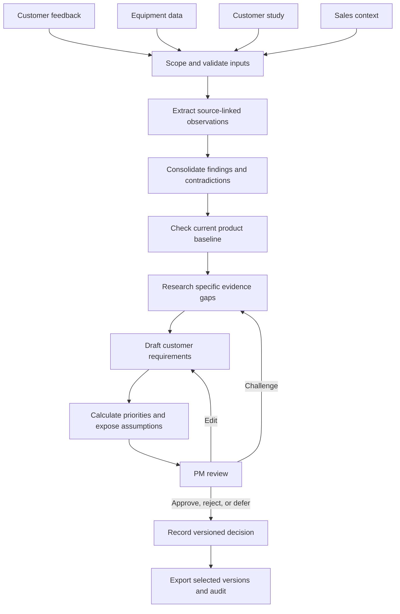
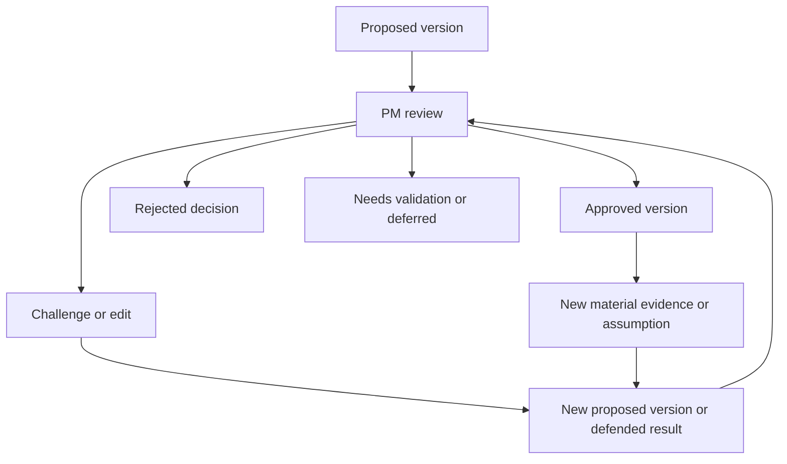
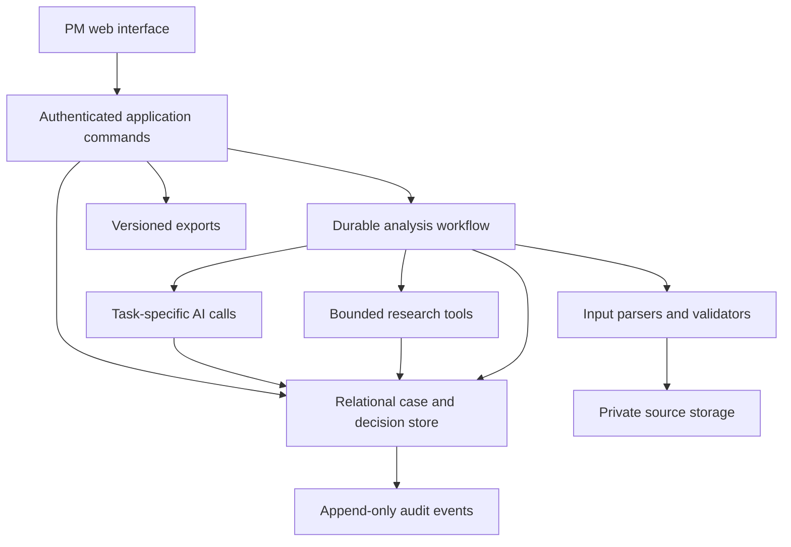

# FWD — AI Vehicle Requirements Lab

## Full product, architecture, and hackathon implementation plan

**Prepared:** 10 October 2026  
**Working title:** FWD; rename to match the team's chosen project name.  
**Document status:** Recommended plan for implementation and demonstration.  
**Starting point:** Build on the team's existing application after checking its current capabilities. Its repository and backend have not been inspected as part of this planning exercise.

> **Recommended direction:** Build one configurable evidence-to-decision engine. Demonstrate one BMW derivative in one market thoroughly. Make the product distinctive through connected BMW evidence and a PM challenge that leads to a defensible decision, with every material change preserved.

> **Evidence status:** The actual BMW Drive datasets have not been analyzed in this conversation. The interactive explorer uses synthetic examples. BMW 5 Series / Europe is a provisional demonstration context; the exact derivative and geography must be selected from the supplied data. All sample requirements, snippets, scores, and decisions in this document are illustrative.

## Contents

1. [Executive recommendation](#1-executive-recommendation)
2. [The eight possible approaches](#2-the-eight-possible-approaches)
3. [Vehicle and market strategy](#3-vehicle-and-market-strategy)
4. [Scope and success criteria](#4-scope-and-success-criteria)
5. [The product experience](#5-the-product-experience)
6. [End-to-end workflow](#6-end-to-end-workflow)
7. [Ingestion and evidence interpretation](#7-ingestion-and-evidence-interpretation)
8. [Web enrichment and verification](#8-web-enrichment-and-verification)
9. [Deriving useful requirements](#9-deriving-useful-requirements)
10. [Prioritization and evidence strength](#10-prioritization-and-evidence-strength)
11. [PM review and challenge workflow](#11-pm-review-and-challenge-workflow)
12. [Audit trail and versioning](#12-audit-trail-and-versioning)
13. [Application architecture](#13-application-architecture)
14. [Data model and command contracts](#14-data-model-and-command-contracts)
15. [Interface design](#15-interface-design)
16. [Implementation in four phases](#16-implementation-in-four-phases)
17. [Acceptance and evaluation](#17-acceptance-and-evaluation)
18. [Structured sample requirements](#18-structured-sample-requirements)
19. [Demonstration and judging story](#19-demonstration-and-judging-story)
20. [Risks, deferred work, and open decisions](#20-risks-deferred-work-and-open-decisions)
21. [Current prototype and final delivery checklist](#21-current-prototype-and-final-delivery-checklist)
22. [Sources and references](#22-sources-and-references)

---

## 1. Executive recommendation

The user's plug-and-play idea is the right product direction when the application makes the analysis context explicit. A vehicle name and an uploaded review file can be the starting experience. Before making a consequential recommendation, the system also needs to establish the market, relevant derivative and generation, observation period, available equipment, customer population, and planning horizon.

The recommended combination has three parts:

| Role | Choice | Purpose |
|---|---|---|
| Product foundation | Configurable shared engine | Reuse ingestion, evidence records, analysis, scoring, PM review, and audit across cases. |
| Analytical focus | BMW evidence interpreter | Connect customer feedback, equipment, sales context, and customer study findings where their scope aligns. |
| Demonstration differentiator | PM challenge and scenario review | Let a PM question the interpretation, inspect targeted checking, compare a revision, and own the decision. |

Start with the best connected evidence package available. The provisional 5 Series / Europe choice is a planning placeholder, not a finding that this package is superior. If another derivative and market have clearer coverage or a more consequential evidence conflict, use that case.

The successor planning horizon should remain explicit throughout the product. The working horizon discussed for the challenge is **3–5 years**. Current complaints establish present experience; their importance for a successor requires a separately documented assumption.

### The central product promise

**For a defined BMW vehicle and market, turn heterogeneous evidence into a reviewable set of customer requirements, explain why each matters, and preserve how the PM reached a decision.**

### The most valuable signature moment

A PM challenges a proposed requirement. The system checks the relevant evidence, returns a defensible answer, and either revises the proposal, narrows it, defends it, or identifies a validation gap. The PM sees the effect on the requirement and its priority, then records a decision on that exact version.

That moment demonstrates the complete chain the briefing asks for: inputs, interpretation, requirement, prioritization, human oversight, and audit. It is a stronger use of hackathon time than implementing every possible data connector or training a model for every market.

## 2. The eight possible approaches

These approaches are not all mutually exclusive. Some describe the architecture, some the user experience, and some the team's analytical focus.

| Approach | What the application does | Best fit | Main tradeoff | Recommendation |
|---|---|---|---|---|
| **1. Single-case specialist** | Analyzes one fixed derivative, market, and prepared dataset. | Very limited time and one excellent evidence package. | Case assumptions can become embedded in code and prompts. | Keep the focused demonstration; make its context configurable. |
| **2. Universal feedback uploader** | Accepts a vehicle name and customer feedback, then proposes needs and requirements. | An accessible entry experience for unfamiliar files. | Reviews alone cannot resolve equipment availability, market applicability, or sample coverage. | Use this as the front door, followed by scope and mapping confirmation. |
| **3. Separate market models** | Trains or fine-tunes distinct model behavior for Europe, China, and the US. | A later experiment with suitable labeled data and a repeatable evaluation. | Adds training and evaluation work while still requiring current evidence and source tracing. | Defer until measured failures show that configuration and retrieval are insufficient. |
| **4. Configurable shared engine** | Runs one workflow using case-specific vehicle, market, source, and horizon settings. | A credible reusable product demonstrated on one case. | Ambiguous inputs require explicit clarification and validation. | **Recommended foundation.** |
| **5. Research-first market radar** | Investigates competitors and trends, then translates external evidence into candidate needs. | A team especially strong in research and verification. | Public claims may be promotional, outdated, or unavailable in the target market. | Use targeted research to resolve specific gaps. It can become the main focus if the supplied data connects poorly. |
| **6. BMW evidence interpreter** | Reconciles feedback, equipment, customer study, and sales context. | A coherent package with useful cross-source relationships. | Joining unrelated populations or time periods can produce misleading conclusions. | **Recommended analytical focus, conditional on data quality.** |
| **7. PM challenge and scenario lab** | Makes evidence, assumptions, scores, and proposed changes inspectable and challengeable. | A memorable demonstration of meaningful oversight. | Depends on a credible evidence pipeline; a chat box alone does not provide this. | **Recommended differentiator.** |
| **8. Living requirements monitor** | Detects new evidence affecting an accepted requirement and proposes reconsideration. | Repeated product planning cycles. | Adds scheduling, monitoring, and review workload. | Stretch capability after the initial decision loop works. |

### Selection rules

- **If time is extremely short:** Build the single-case demonstration using the shared schema, source links, scoring function, and versioned decisions. Support only the formats actually supplied.
- **If BMW inputs connect well:** Follow the recommended combination of shared engine, BMW evidence interpretation, and PM challenge.
- **If BMW inputs are sparse or difficult to relate:** Reduce the number of requirements and deepen targeted external research. Keep the missing BMW evidence visible.
- **If extra time remains:** Test a second case and one assumption-sensitivity interaction before adding continuous monitoring.

Separate market training becomes a reasonable research option only when a stable evaluation reveals a recurring failure, enough suitable examples exist, and training improves that failure without weakening evidence traceability.

## 3. Vehicle and market strategy

### 3.1 What should be reusable

Reuse the source schema, extraction contracts, requirement structure, prioritization implementation, review actions, versioning, and audit logic. Input adapters may also be reused when files share a structure.

### 3.2 What should change with the case

| Context | Why it matters |
|---|---|
| Exact derivative and generation | Prevents a feature or complaint from being attributed to the wrong vehicle. |
| Market and any known submarket | Determines which local evidence and availability claims are applicable. |
| Equipment, variant, package, and relevant software context | Helps distinguish missing capability from availability or usability problems. |
| Observation window | Keeps older experiences distinguishable from the current baseline. |
| Customer population | Allows findings to remain scoped to the group actually observed. |
| Successor horizon | Separates current evidence from assumptions about future relevance. |
| Language | Supports retrieval and interpretation while preserving original evidence. |
| Competitor set | Keeps comparisons relevant to the target decision. |
| Scoring policy | Makes priorities interpretable within an agreed context. |

Market context should come from documented evidence and explicit configuration. Avoid hardcoded cultural assumptions such as assigning a feature a higher score simply because a market label is China, Europe, or the US.

### 3.3 Demonstration-case selection

Inspect the available packages before committing to the provisional case. Prefer a package with:

1. A clearly identifiable derivative and market.
2. Useful customer feedback with traceable records.
3. Equipment information applicable to the same case.
4. A customer study or another independent source of customer context.
5. Sales information whose population and period are understandable, where supplied.
6. At least one meaningful uncertainty or disagreement between sources.
7. Enough clarity to derive a small, defensible requirement set.

Do not choose solely by file size or number of reviews. A smaller coherent package can support a stronger demonstration.

**A vehicle family is not an exact derivative.** Replace “5 Series” with the applicable derivative before claiming the required derivative-level demonstration. If the dataset defines “Europe” as its market, retain that definition and its limits; do not invent country-level coverage.

### 3.4 Case configuration example

```yaml
case_id: CASE-DEMO-001
vehicle_family: BMW 5 Series
derivative: null                 # Resolve from the actual supplied data.
generation: null
market: Europe                  # Provisional; confirm the dataset's definition.
submarket: null
observation_period:
  start: null
  end: null
successor_horizon_years: [3, 5]
objective: Derive customer requirements for the successor vehicle
scoring_policy: customer-priority-v1
evidence_mode: synthetic         # Replace only after real inputs are loaded.
scope_status: needs_confirmation
```

Changing the derivative or market creates a separately scoped analysis. The application can reuse its methods and supported adapters; previous scores and approvals do not automatically apply to the new case.

## 4. Scope and success criteria

### 4.1 In scope for vehicle requirements

Customer outcomes involving features, equipment, comfort, space, usability, infotainment, digital services, design and quality perception, driving experience, experienced range and charging, and variant or package offerings.

### 4.2 Out of scope for vehicle requirements

- Regulatory and homologation requirements, including type approval and mandatory compliance specifications.
- Vehicle engineering requirements, including components, architecture, supplier choices, and detailed system specifications.
- Pricing, business cases, and cost calculations.

A rough implementation-effort assessment may inform prioritization when qualified and supported. It must not turn into a speculative cost model.

The application's own software architecture is naturally part of implementation. The scope restriction concerns the vehicle requirements it produces.

### 4.3 Deliverable mapping

| BMW deliverable | What the team should present |
|---|---|
| **D1 — Concept and prototype** | A working path from supplied inputs to proposed requirements, priorities, and PM decisions. |
| **D2 — Structured requirement list** | Stable IDs, actionable descriptions, linked findings and sources, score and rationale, evidence level, future assumptions, uncertainties, and decision status. |
| **D3 — End-to-end workflow** | A clear diagram and working behavior showing autonomous analysis and mandatory PM decisions. |
| **D4 — Demonstrable audit trail** | Source-to-decision traceability, changes, actors, timestamps, rationales, versions, and relevant access events. |

### 4.4 Proposed success target

Aim for a manageable set of approximately **6–10 reviewed candidate requirements** from the actual case, with **one requirement demonstrated deeply**. These are planning targets, not claims about how many valid requirements the data will support.

Quality takes precedence over reaching a count. The system should explicitly report insufficient support when the evidence cannot justify a requirement.

## 5. The product experience

### 5.1 Starting a case

The PM enters the vehicle and market and uploads the available data. The system inspects formats and suggests mappings, then shows a concise confirmation screen containing:

- Recognized derivative, market, period, and source categories.
- Proposed column or document mappings.
- Missing categories and unsupported files.
- Material ambiguities that affect interpretation.
- The planning objective and successor horizon.

The PM corrects or confirms consequential ambiguity. Routine parsing and supported mappings continue automatically.

### 5.2 Running analysis

The application continues processing as a background workflow. Progress should describe completed work and unresolved questions, such as “equipment baseline checked” or “two claims need market verification.” Avoid invented progress percentages when the remaining work is unknown.

The user can leave the screen and return to the persisted case. A failed research step should preserve completed work and expose the specific gap.

### 5.3 Reviewing results

The PM opens a prioritized list. Each requirement shows its customer outcome, applicable case, evidence strength, rationale, future assumptions, and current status. A detail view opens the supporting and contradictory evidence at its original location.

### 5.4 Making a decision

The PM can approve, reject, edit, challenge, or defer a requirement. The application records the rationale and exact version. Later material changes appear as a new proposal while the approved version remains inspectable.

### 5.5 Producing the output

The PM selects the requirement set to export. The export identifies the exact versions and decision state, includes evidence references and scoring explanations, and provides the relevant audit history.

## 6. End-to-end workflow



Audit events are recorded throughout this workflow. They are not reconstructed at the end.

| Stage | AI may perform | Application code owns | Mandatory PM involvement |
|---|---|---|---|
| Case setup | Suggest context and mappings. | Validate scope and flag ambiguity. | Confirm consequential scope or mapping uncertainty. |
| Ingestion | Interpret difficult structures where needed. | Parse, preserve locations, hash versions, report failures. | Resolve failures that materially affect the case. |
| Observation extraction | Extract complaints, needs, positive signals, and product facts. | Validate structured output, source references, and quoted spans. | Review flagged interpretations. |
| Consolidation | Group related observations and identify conflict. | Calculate counts, track duplicates, preserve relationships. | Challenge consequential merges or interpretations. |
| Baseline and research | Investigate applicability, current availability, competitors, and trends. | Record evidence, dates, budgets, and errors. | Resolve remaining strategic uncertainty. |
| Requirements | Propose customer outcomes and assumptions. | Validate required fields and scope. | Review proposed requirements. |
| Prioritization | Propose ratings and concise rationales. | Compute scores from a versioned policy. | Accept or change the judgments underlying the decision. |
| Decision | Explain findings and prepare revisions. | Authenticate and validate decision commands. | Approve, reject, edit, challenge, or defer. |
| Export | Optionally draft readable summaries. | Export exact versions and record the export event. | Choose the accepted set. |

## 7. Ingestion and evidence interpretation

### 7.1 Support the supplied formats first

Inventory the actual files before choosing parsers. Support the CSV, spreadsheet, document, PDF, or other formats actually present. A heterogeneous prototype needs to demonstrate meaningful interpretation across the supplied source categories; a universal connector marketplace is unnecessary.

Keep the raw input private and unchanged. Store parsed content and analysis outputs separately, with references back to the immutable input version.

### 7.2 Preserve exact provenance

Every evidence unit should contain:

- Source version ID and original filename or URL.
- Exact locator: review ID, sheet and row/cells, PDF page, or captured web passage.
- Original text or structured value.
- Observation, publication, and retrieval dates where available; unknown values remain unknown.
- Vehicle, market, generation, variant, and population applicability where known.
- Parser and extraction-run identifiers.
- Duplicate or independence grouping.
- Translation linked to the original, when used.

The evidence viewer should open the locator that supports the claim, rather than presenting only a document title or homepage.

### 7.3 Keep three layers distinct

| Layer | Example | Meaning |
|---|---|---|
| Observation | A review states that a comfort shortcut was difficult to find. | What the source actually reports. |
| Finding | The evidence suggests a discoverability problem, while equipment information indicates a shortcut exists. | An interpretation that can be challenged. |
| Requirement | Make frequently used comfort shortcuts visible and easy to customize. | A proposed customer outcome. |

An observation should not become an approved requirement automatically.

### 7.4 Interpret each dataset according to what it can establish

| Source category | Useful contribution | Limit |
|---|---|---|
| Customer feedback | Experienced problems, unmet needs, valued features, customer language. | Review recurrence does not establish population prevalence. |
| Customer study | Stated priorities, observed tasks, subgroup context, structured customer evidence. | Findings remain subject to the study's sample, method, and dates. |
| Equipment | Availability, package and variant context, current feature baseline. | Availability does not prove usability or customer demand. |
| Sales | Composition of an observed purchasing cohort and product context. | Purchases alone do not establish why customers bought. |
| Web evidence | Applicable competitor facts, product changes, external research, and dated trends. | A public claim needs verification for the target market and period. |

### 7.5 Consolidation and counts

Use deterministic calculations for counts, joins, and rates. Preserve the eligible denominator and explain the population being counted. Keep review counts, distinct authors where known, and independent-source groups separate.

Copied reviews, translations of the same review, and syndicated articles must not be counted as independent support. A merge should retain all underlying observations, contradictory evidence, the merge rationale, and its initiating run or person.

Where datasets cannot be joined reliably, present them as separate evidence. Do not create artificial customer-level relationships between unrelated feedback and sales records.

### 7.6 Organizer data and repository handling

The organizers explicitly asked teams to keep the provided input data out of repositories. Keep raw inputs, normalized copies, extracted passages, private exports, and evidence-bearing caches outside tracked repository content.

An example `.gitignore` policy is:

```gitignore
/data/raw/
/data/private/
/data/normalized/
/uploads/
/artifacts/private/
/exports/private/
/.local-runs/
/.env
/.env.*
!/.env.example
```

Adapt paths to the existing app. Commit application code and clearly synthetic fixtures. Before pushing, inspect staged files for source extracts in logs, screenshots, examples, and exports; ignoring the original spreadsheet alone is insufficient.

## 8. Web enrichment and verification

### 8.1 Research questions should be specific

Useful questions include:

- Is the relevant feature available on this derivative, in this market, during the observation period?
- Does a competitor offer a customer experience that addresses the same need?
- Is a cited capability currently available, announced, or only proposed?
- Does independent evidence support or contradict the interpretation?
- What evidence supports the assumed future relevance?

Avoid running an open-ended search for “what customers want” and using the resulting summary as an unqualified source.

### 8.2 Store structured external evidence

For each material web claim, store the claim, supporting passage, canonical URL, publisher, relevant dates, product and market applicability, evidence type, verification state, and any unresolved limitations.

Official product pages are useful for availability claims. They do not by themselves establish customer satisfaction or market demand. Match the source type to the claim being made.

Maintain explicit states such as `available`, `announced`, `unclear`, and `not_applicable`. A competitor announcement must not silently become an available feature in the target market.

### 8.3 Use a bounded research workflow

Begin with a short list of evidence gaps. Give each research run a configurable query, source, and time budget. Stop when the question is answered with applicable evidence, counterevidence is documented, or the budget is reached.

Return a clear unresolved result when access or evidence is insufficient. Preserve query history, inspected sources, accepted evidence, rejected applicability, and the reason for stopping.

The PM can request a deeper investigation. Long-running work should continue through persisted jobs rather than requiring the browser tab to remain open.

### 8.4 Validate the link between claim and source

A citation being present is insufficient. Check that the referenced passage exists, concerns the correct context, and supports the specific claim. Use a manual review sample for consequential findings and automated checks for source identity and quoted-span existence.

Treat imported and retrieved text as evidence. Instructions embedded in that content must not gain authority to change the workflow, access unrelated data, or issue PM decisions.

## 9. Deriving useful requirements

### 9.1 Requirement structure

A good requirement describes a customer, the context in which a need arises, and an observable outcome. It should be understandable to a PM without requiring a proposed vehicle engineering solution.

Example pattern:

> For [target customer/context], enable [customer outcome] so that [experienced benefit], within [relevant case scope].

Do not force every sentence into that wording. Prefer clear, direct language.

### 9.2 Quality rules

- Express one main customer outcome per requirement.
- Link the requirement to consolidated findings and exact evidence.
- Distinguish a missing feature from an existing feature that is unavailable, hard to discover, or difficult to use.
- Include counterevidence that materially affects the interpretation.
- State future assumptions and uncertainties explicitly.
- Add observable validation criteria where useful.
- Keep engineering implementation, regulatory obligations, and business-case calculations out of the requirement.
- Treat unsupported performance targets as proposals requiring PM validation.

“Improve infotainment” is too vague. “Make frequently used comfort controls easy to find and personalize from the main interface” provides a clearer customer outcome. A proposed usability study can validate that outcome; the application should not invent a validated completion-time target.

### 9.3 Required fields

| Field | Required content |
|---|---|
| Stable requirement ID | Identifier that survives edits. |
| Version ID and predecessor | Exact reviewable artifact and its lineage. |
| Case scope | Derivative, market, period, and successor horizon. |
| Description | Clear, actionable customer outcome. |
| Category | Relevant product-experience category. |
| Linked findings | Interpretations from which the requirement was derived. |
| Linked evidence | Supporting and contradictory source versions and locators. |
| Priority | Score or incomplete-assessment state, factors, weights, and policy version. |
| Prioritization rationale | Why each factor received its rating. |
| Evidence level | Rubric result and explanation of support and limitations. |
| Future assumptions | Conditions under which the requirement remains relevant. |
| Uncertainties | Missing evidence, competing interpretations, and validation questions. |
| Validation approach | How the customer outcome could be assessed. |
| Decision status | Proposed, needs validation, approved, rejected, or deferred. |
| Decision record | Actor, time, rationale, and exact version. |

## 10. Prioritization and evidence strength

### 10.1 Initial scoring policy

Use four ordinal ratings from **0 to 5**. These are explained judgments, not measured probabilities.

| Factor | Weight | Question |
|---|---:|---|
| Customer impact, I | 35% | How consequential is this outcome for the customer experience or task? |
| Breadth in the target group, B | 25% | How broadly relevant is the need within the supported customer context? |
| Gap in the current offering, G | 20% | How far is the current available experience from the needed outcome? |
| Future relevance, F | 20% | How important is the outcome under the stated successor assumptions? |

```text
Priority = 35 × I/5 + 25 × B/5 + 20 × G/5 + 20 × F/5
```

Code calculates the result. Store the ratings, rationales, weights, unrounded total, and policy version. Display a whole-number score out of 100.

### 10.2 Rating anchors

| Factor | 0 | 1 | 3 | 5 |
|---|---|---|---|---|
| Impact | No applicable customer benefit identified. | Minor inconvenience. | Meaningful recurring friction or reduced experience. | Major effect on an important customer task or experience. |
| Breadth | No applicable target group identified. | Narrow observed use case. | Relevant to a meaningful supported subgroup. | Broad relevance supported across relevant groups or contexts. |
| Gap | Applicable current experience adequately meets the need. | Small improvement opportunity. | Material usability, availability, or experience gap. | Major supported unmet customer outcome. |
| Future relevance | Outside the stated future use case. | Low relevance under the selected assumptions. | Plausibly persistent need with explicit uncertainty. | Strong relevance under documented future assumptions and supporting signals. |

Ratings 2 and 4 represent intermediate judgments. **Missing information is `null`, not 0.** If an essential factor cannot be assessed, show an incomplete assessment and the missing input; do not silently manufacture a definitive rank.

### 10.3 Interpretation rules

- Breadth is a scoped judgment. Show underlying sample counts and denominators separately; do not call review frequency market prevalence.
- An existing feature can still have a substantial experience gap. Equipment availability alone does not require a zero gap rating.
- Future relevance must identify the assumptions driving it. It is not an established forecast.
- Compare scores within compatible case and scoring contexts. A score of 75 in one market is not automatically comparable to 75 in another.
- Reweighting factors changes the policy. Record the new policy and affected proposed versions; preserve previously approved versions with their original weights.
- Keep rough effort separate initially. `Unknown` is valid. A PM can use supported effort as a tie-breaker with a recorded rationale.

### 10.4 Optional priority bands

The following are proposed communication bands, subject to PM confirmation:

| Score | Suggested band |
|---|---|
| 85–100 | Highest priority for review |
| 70–84 | High |
| 50–69 | Medium |
| 0–49 | Lower |
| Incomplete factors | Needs assessment |

Bands organize review. They do not constitute automatic approval or an engineering commitment.

### 10.5 Evidence strength is a separate assessment

| Level | Meaning | Typical treatment |
|---|---|---|
| **E0 — Unsupported** | No verified applicable support, or synthetic examples only. | Keep as an explicit hypothesis or demonstration; validate before a real product decision. |
| **E1 — Limited** | Some applicable evidence, with narrow coverage, weak independence, or material uncertainty. | Investigate or request customer validation. |
| **E2 — Supported** | Relevant, inspectable evidence with reasonable corroboration and understood limitations. | Suitable for PM review with remaining assumptions visible. |
| **E3 — Strong** | Multiple suitable, sufficiently independent sources with strong scope match and reviewed contradictions. | Higher confidence in the interpretation; PM still owns the decision. |

Assess source suitability, scope match, independence, coverage, recency, and contradictions. A large number of similar weak sources should not automatically produce E3.

Keep three fields distinct in the interface:

1. **Priority:** How important the outcome appears to be.
2. **Evidence strength:** How well the interpretation is supported.
3. **Decision status:** What the PM has decided.

High priority with limited evidence should remain visible as an important investigation opportunity. The PM may accept a qualified requirement with a documented assumption or validation condition; the application must not disguise that judgment as stronger evidence.

### 10.6 Sensitivity example

The synthetic comfort-control example starts with I=4, B=3, G=4, F=4:

```text
28 + 15 + 16 + 16 = 75
```

After the gap rating changes to G=2:

```text
28 + 15 + 8 + 16 = 67
```

After exploring a lower future-relevance assumption, F=3:

```text
28 + 15 + 8 + 12 = 63
```

The score changes have different meanings: the first follows a changed baseline interpretation; the second follows a scenario assumption. Record that distinction. Do not automatically apply a scenario to an approved requirement.

## 11. PM review and challenge workflow

### 11.1 Review actions

| Action | Result |
|---|---|
| Approve | Record acceptance of one exact version with a rationale. |
| Reject | Record rejection of one exact version with a rationale. |
| Edit | Create a proposed version with changed wording and a reason. |
| Challenge | Investigate a specific interpretation, source, scope, rating, or assumption. |
| Defer / needs validation | Preserve the proposal and the question that must be resolved. |

Approval should cover the displayed wording, evidence references, assumptions, ratings, weights, and rationale. The PM should not be approving an unspecified moving draft.

### 11.2 Challenge sequence

1. Bind the PM's question to a specific requirement version.
2. Record the question, initiator, time, and target.
3. Convert it into a bounded investigation.
4. Inspect relevant existing evidence and conduct targeted research when needed.
5. Validate and record accepted new evidence.
6. Return one of four outcomes: defended, revised/narrowed, needs validation, or no conclusion.
7. Show changes to wording, evidence, assumptions, ratings, and score.
8. Let the PM decide on the resulting version.

Useful presets include “Does the function already exist?”, “Is this evidence from the correct market?”, “Are these independent reports?”, “What contradicts this finding?”, and “Which future assumption drives this priority?”. Also support a free-text challenge.

The system must be able to defend a proposal when the evidence supports it. It should not always agree with the PM or create a new version merely to appear responsive.

### 11.3 Material changes and decisions



An approved version remains available while its successor is reviewed. Display “Approved v2; proposed v3 awaiting review” when appropriate.

A reversal is a new decision event with a reason. Concurrent edits should be detected using an expected-version check, so the PM cannot accidentally approve a version that changed after they opened it.

### 11.4 A credible live challenge

The actual pipeline should check the equipment baseline before proposing requirements. For the live demonstration, choose a genuinely unresolved ambiguity, newly introduced evidence, a scope issue, or a future assumption that merits PM attention.

The synthetic walkthrough intentionally demonstrates correction of an incomplete interpretation. Do not stage a live system that deliberately ignores already-known evidence just to create a dramatic correction.

## 12. Audit trail and versioning

### 12.1 What must be recorded

Record case setup and scope confirmation, uploads and source versions, parsing outcomes, source inspections, extraction runs, consolidation changes, baseline checks, web retrievals, requirement creation, scoring and policy changes, PM challenges, edits, decisions, and exports.

Include relevant authenticated application access and failed or denied actions where they affect the case. Define the event inventory explicitly so that “complete audit trail” has an implementable application boundary.

### 12.2 Event fields

```json
{
  "event_id": "EVT-SYN-008",
  "case_id": "CASE-DEMO-001",
  "case_sequence": 8,
  "occurred_at": "2026-10-10T12:00:00Z",
  "actor_type": "pm",
  "actor_id": "synthetic-demo-pm",
  "action": "requirement.approved",
  "requirement_id": "REQ-001",
  "requirement_version": 2,
  "previous_decision_id": null,
  "initiating_challenge_id": "CH-SYN-001",
  "before_ref": "REQ-001:v2:proposed",
  "after_ref": "DEC-SYN-001",
  "rationale": "Illustrative approval of the discoverability requirement.",
  "evidence_refs": ["F-014:v1", "E-009:v1", "S-004:v1"],
  "evidence_mode": "synthetic"
}
```

This is a schema example with an invented timestamp and actor, not a recorded real PM action. Store server-generated UTC timestamps and a deterministic event sequence for the real application.

### 12.3 Audit invariants

1. Requirement and source versions are immutable.
2. Material changes create a new requirement version.
3. A complete version includes wording, findings, source versions, assumptions, evidence assessment, factors, weights, and rationale.
4. Approval references one exact version.
5. Decision reversals preserve earlier decisions.
6. State mutation and its audit record commit atomically.
7. Retries are idempotent and do not duplicate decisions or revisions.
8. A later source update cannot change the evidence behind an earlier approval.
9. A market or derivative change cannot silently inherit an earlier decision.
10. AI/service operations cannot issue a PM approval.

The audit should preserve concise rationales, relevant inputs and outputs, model and prompt identifiers, and validation results. It does not require hidden model reasoning.

### 12.4 Viewing and exporting history

Provide a chronological history with filters for requirement, actor, action, and time. A latest-first view is acceptable if clearly labeled and reversible. Let the PM open any version, compare material fields, and inspect preserved approvals.

Use append-only application permissions for audit events. Do not describe an ordinary application database as tamper-proof. Stronger administrative controls or tamper-evidence can be added later if required; the hackathon goal is demonstrable, durable traceability.

## 13. Application architecture

### 13.1 Proposed technical approach

Keep the existing team stack wherever it can support the required behavior. If a baseline is needed, a TypeScript web application, PostgreSQL, private object storage, and a durable background-job mechanism are a practical design choice.

For a team already using Next.js and Supabase, these can provide the interface/API layer and relational/auth/storage foundation. Treat provider selection as an implementation choice, not an additional hackathon objective. No specific provider, subscription, or deployment is assumed to have been selected or configured.



### 13.2 Keep responsibilities explicit

| Responsibility | Owner |
|---|---|
| Interpretation, semantic grouping, drafting, challenge investigation | AI calls with narrow contracts. |
| Parsing, counts, joins, arithmetic, validation, authorization, versioning | Application code. |
| Source bytes and captured evidence | Private storage with immutable source-version references. |
| Case state, findings, versions, decisions, audit | Relational database. |
| Accepted requirements and strategic judgments | Authenticated PM. |

A relational model can represent the traceability graph through IDs and link tables. A separate graph database is unnecessary for the initial implementation.

### 13.3 AI integration

Use task-specific prompts and structured outputs for extraction, finding consolidation, baseline interpretation, requirement drafting, and challenge responses. Supply only relevant case evidence.

Validate schemas, referenced source IDs, locators, quoted passages, and required fields before publication. Keep draft outputs separate from accepted records. Record model and prompt versions on every run.

Start with retrieval over normalized sources and explicit case filters. Add embeddings or more elaborate retrieval only when the corpus and observed retrieval failures justify it. Fine-tuning is a later option requiring evaluation, not a prerequisite for supporting another market.

### 13.4 Background execution

A run should persist its case configuration, input versions, step status, outputs, errors, and idempotency keys. Completed steps should be reusable after interruption. Research and parsing retries must not duplicate findings, requirements, or decisions.

Use bounded concurrency and inspectable failure states. A schema failure should trigger a controlled retry or review state, not silent publication of malformed results.

### 13.5 Avoid unnecessary infrastructure

Begin with one application backend, one relational store, private source storage, and a small number of bounded analysis tasks. Add another service only to resolve a concrete capability or reliability requirement.

The team should spend its strongest effort on evidence interpretation and PM decision quality. A complex agent-management interface is not required to demonstrate either.

## 14. Data model and command contracts

### 14.1 Core records

| Entity | Important fields |
|---|---|
| Case and configuration version | Scope, objective, horizon, evidence window, scoring policy, known limitations. |
| Source version | Type, filename/URL, private location, content hash, dates, scope, parser version, duplicate group. |
| Evidence span | Source version, exact locator, original excerpt/value, linked translation. |
| Observation | Extracted statement, evidence spans, category, applicability, extraction run. |
| Finding version | Interpretation, supporting/contradicting observations, counts, denominator, limits, consolidation lineage. |
| Requirement | Stable identity, case, current proposed-version pointer, current approved-version pointer. |
| Requirement version | Full reviewable content, predecessor, immutable evidence/finding references, ratings, policy, assumptions, author/run. |
| Challenge | Target version, PM question, requested checks, run, result, resulting revision. |
| Decision | Version, authenticated actor, action, rationale, time, superseded decision reference if any. |
| Analysis run | Input/context versions, step states, model/prompt/parser versions, budget, outputs, errors, retry keys. |
| Audit event | Case sequence, timestamp, actor, action, object/version, initiating operation, diff/references, rationale. |
| Export manifest | Selected requirement versions, decision state, policy/source references, generation time, export event. |

Use link tables or equivalent structured relationships for finding-to-observation and requirement-to-finding connections. Preserve both supporting and contradicting relationships.

Decision status can be a projection of decision and review events. Keep immutable content versions distinct from changing status so that an approval or reversal does not rewrite the underlying artifact.

### 14.2 Application commands

| Command | Required behavior |
|---|---|
| Create/confirm case | Validate scope and record configuration version. |
| Import source | Create source version, provenance, parsing result, and audit event. |
| Run analysis | Bind the run to exact input and context versions. |
| Create requirement revision | Require predecessor/expected version and reason; preserve previous content. |
| Change scoring policy | Version policy and identify affected proposed results. |
| Challenge requirement | Bind question to a version and start a bounded investigation. |
| Decide on requirement | Require authenticated PM, exact version, permitted action, and rationale. |
| Open evidence | Authorize and record the relevant source access. |
| Export requirement set | Resolve exact versions and record a manifest and audit event. |

Mutating commands need validated inputs, server-side authorization, idempotency identifiers, and transactional state/audit writes. The UI hiding an action is not sufficient enforcement.

If a user's open version is stale, show the newer version and require a fresh decision. Do not silently apply their approval to an unseen revision.

## 15. Interface design

The interactive concept explorer contains four explanatory views: Options, Workflow, Try the design, and Build priorities. The production application should organize around PM work rather than retaining that strategy-explainer navigation.

### 15.1 Recommended application areas

| Area | Main content and actions |
|---|---|
| Case overview | Vehicle, market, horizon, coverage, processing state, unresolved inputs, and next PM action. |
| Inputs and evidence | Import mappings, source categories, dates, original locators, applicability, and evidence gaps. |
| Findings | Consolidated needs, independent support, counterevidence, exclusions, and merge history. |
| Requirements | Priority list, evidence level, decision status, category, and review filters. |
| Requirement review | Customer outcome, factor rationale, assumptions, evidence, challenges, edits, and decisions. |
| Audit and export | Event history, version comparisons, preserved approvals, and selected-version export. |

These can be pages or panels within the existing app; they do not require six separate subsystems.

### 15.2 Requirement detail layout

At the top, show the stable ID, version, description, case scope, priority, evidence level, and status. Use local tabs for Evidence, Priority, and History, following the concept explorer.

Evidence should show support and contradictions together. Priority should expose factors and rationales. History should expose complete versions, not only the most recent text diff.

Keep approve, reject, edit, and challenge available without hiding them inside a generic chat conversation. The rationale field belongs directly with the action.

### 15.3 Interaction requirements

- Opening evidence must preserve unfinished edits and decision rationales.
- Keyboard focus should remain meaningful after an update.
- Narrow layouts should wrap or stack without clipping controls.
- Synthetic, prepared, and live results must be visibly distinguishable.
- An unsupported case should show missing evidence rather than inherited scores.
- A scenario remains a preview until the PM applies it as a proposed revision.
- Successful mutations should show the new version or decision and a link to its history.

## 16. Implementation in four phases

The schedule depends on team size, remaining time, existing code, and the actual file formats. Use these as ordered delivery gates. Audit capture starts in Phase 1 and continues throughout.

### Phase 1 — Establish the case and evidence foundation

**Goal:** Make every conclusion refer to an identifiable, appropriately scoped input.

**Work:**

1. Inspect the existing app against D1–D4 and retain working capabilities.
2. Inventory the supplied files and choose the strongest demonstration case.
3. Establish the case, source, evidence, finding, requirement, run, decision, and audit contracts.
4. Implement adapters for the actual formats with a mapping preview.
5. Preserve exact source locators and immutable source versions.
6. Flag missing categories, mismatched scope, and parsing failures.
7. Establish private data paths, repository exclusions, and initial audit capture.

**Gate 1:** The case is explicit; supported files import; source references open the intended evidence; mismatched or uncertain records remain visible; ingestion and relevant access events are recorded.

**Deliverables advanced:** D1, D3, D4.

### Phase 2 — Produce defensible requirements and priorities

**Goal:** Complete the autonomous evidence-to-proposal path.

**Work:**

1. Extract observations with source references.
2. Consolidate findings while preserving duplicates, independent support, and counterevidence correctly.
3. Reconcile relevant customer, equipment, study, and sales context.
4. Run baseline checks and targeted web research.
5. Draft customer requirements with future assumptions and uncertainties.
6. Implement deterministic scoring and separate evidence assessment.
7. Populate the structured requirement list and evidence viewer.

**Gate 2:** Each material factual finding has applicable evidence; the sample requirement list contains all D2 fields; current observations and future assumptions are distinguishable; priorities are reproducible; unresolved evidence remains visible.

**Deliverables advanced:** D1, D2, D3, D4.

### Phase 3 — Complete the PM decision loop

**Goal:** Make human oversight consequential and durable.

**Work:**

1. Implement approve, reject, edit, challenge, and a validation/defer outcome.
2. Bind decisions and challenges to exact versions.
3. Show research outcomes and material comparisons.
4. Preserve approved artifacts while revisions await review.
5. Record actor, initiator, time, reason, before/after references, and evidence.
6. Add expected-version and idempotency handling.
7. Export selected versions and audit history.

**Gate 3:** A PM can complete the review actions; a challenge can revise or defend a proposal; insufficient evidence is explicit; approvals cannot be silently overwritten; retries do not duplicate mutations; the audit reconstructs the decision.

**Deliverables advanced:** D1–D4.

### Phase 4 — Validate, package, and rehearse

**Goal:** Deliver a coherent demonstration supported by actual evidence.

**Work:**

1. Manually verify the demonstration requirements against the source material.
2. Select a genuine conflict or consequential uncertainty for the live challenge.
3. Verify exported records against application state.
4. Show the workflow and responsibility boundaries clearly.
5. Rehearse with a transparently prepared initial analysis.
6. Keep PM actions and audit inspection live where practical.
7. Test a second supplied case only after the primary case is complete.
8. Inspect staged repository content for organizer data and extracts.

**Gate 4:** All expected deliverables are demonstrable, the evidence is real and applicable, preparation is disclosed, the export is consistent, and the demo fits the allotted time.

### Dependencies and parallel work

| Track | Can start | Dependency |
|---|---|---|
| Data and provenance | Immediately. | Establishes case coverage and source contracts. |
| Review UI and audit | During Phase 1 using synthetic fixtures. | Needs shared requirement, version, and event contracts. |
| Extraction and research | Once source contracts stabilize. | Needs scoped evidence and provenance. |
| Scoring | During Phase 1 after agreeing the factor contract. | Integrates with requirement versions in Phase 2. |
| Verification and demo | Define checks during Phase 1. | Final rehearsal needs the completed review/export loop. |

**Critical path:** scoped sources → findings → requirements and priorities → PM decisions → versioned export.

For a small team, combine tracks rather than creating separate owners for every entity. Agree on contracts before running UI and pipeline implementation in parallel.

## 17. Acceptance and evaluation

### 17.1 Evaluation approach

Create a small manually reviewed set from the actual inputs. Include different source types, a duplicate, a scope mismatch, a genuine contradiction, and at least one uncertain future assumption.

Assess whether claims are supported, source locations are correct, consolidation is reasonable, requirements are customer-facing, and uncertainty is represented accurately. Record actual observed results; do not publish invented model-quality percentages.

### 17.2 Meaningful acceptance checks

| Check | Expected result |
|---|---|
| Heterogeneous ingestion | Supported supplied formats preserve their original source locations. |
| Citation integrity | Invented source IDs and unsupported quoted spans fail validation. |
| Scope isolation | Wrong-market, wrong-derivative, or obsolete-context evidence is excluded or flagged. |
| Duplicate handling | Copies and translations of the same evidence do not increase independent support. |
| Counts and joins | Known fixture counts and denominators match deterministic calculations. |
| Contradiction handling | Credible counterevidence remains visible and affects interpretation or uncertainty where appropriate. |
| Baseline check | Existing availability is distinguished from missing capability and usability problems. |
| Requirement quality | Reviewed requirements are actionable customer outcomes with no unflagged scope violations. |
| Scoring | The synthetic 75 → 67 → 63 sequence is reproduced; missing factors remain incomplete. |
| Evidence separation | Changing evidence level does not secretly change the priority formula. |
| Human authority | AI credentials cannot approve; unauthenticated or rationale-free approval fails. |
| Challenge outcomes | The system can revise, defend, or report insufficient evidence. |
| Version preservation | Changes to wording, evidence, assumptions, ratings, or weights preserve complete earlier approvals. |
| Concurrent review | A stale-version approval is rejected with a clear refresh/review path. |
| Draft preservation | Opening evidence does not erase unfinished PM edits or rationales. |
| Retry and recovery | Interrupted jobs resume safely; repeated commands do not duplicate decisions or revisions. |
| Export integrity | Exported requirement versions and statuses match the chosen set and manifest. |
| Audit reconstruction | The source-to-decision history can be reconstructed with actors, timestamps, and rationales. |
| Repository hygiene | Raw organizer data and derived private extracts are absent from tracked content. |
| Adaptability claim | A second case is claimed as tested only if it has actually run successfully. |

Use focused tests for the consequential invariants above. Avoid large suites that only duplicate implementation details. Review representative UI behavior at desktop and narrow widths in a working browser before the final demonstration.

## 18. Structured sample requirements

### 18.1 Status of these examples

The following examples match the direction of the interactive concept. They are synthetic teaching and implementation fixtures. They do not establish actual BMW customer needs, equipment facts, or study results.

For a real product decision, their evidence level is **E0 — Unsupported**, because the supporting snippets are invented. Their numeric priorities demonstrate the formula only.

### 18.2 Synthetic evidence catalog

| Evidence ID | Type | Illustrative content | Relationship |
|---|---|---|---|
| F-014 | Feedback | A customer cannot find a shortcut for frequent comfort tasks. | Supports a usability need. |
| E-009 | Equipment | A configurable comfort shortcut exists in the illustrated configuration. | Challenges the interpretation of a missing feature. |
| S-004 | Study | Fictional participants need help locating shortcut customization. | Adds context for discoverability. |
| F-026 | Feedback | Included and separately activated digital services are unclear. | Supports clearer package information. |
| E-018 | Equipment | The illustrated package lists an activation step separately. | Adds offering context. |
| S-011 | Study | Fictional participants choose appropriately after activation conditions are explained. | Supports explanation rather than extra equipment. |
| F-037 | Feedback | A rear passenger asks the driver to change comfort settings. | Supports passenger independence. |
| E-031 | Equipment | Independent rear controls exist in the fictional comfort package. | Challenges a missing-capability interpretation. |
| S-017 | Study | The fictional study has limited rear-passenger coverage. | Limits breadth claims. |

In an implementation fixture, each row should point to a synthetic source-version record and exact synthetic locator. Replace these with actual source records before presenting data-derived results.

### 18.3 Synthetic findings

| Finding ID | Interpretation | Evidence and limitation |
|---|---|---|
| FIND-001 | Difficulty discovering and customizing an existing comfort shortcut may explain the complaint. | F-014, E-009, S-004; synthetic and unvalidated. |
| FIND-002 | Clearer explanations of included functions and activation conditions may address package-selection confusion. | F-026, E-018, S-011; synthetic and unvalidated. |
| FIND-003 | Rear-passenger difficulty may concern discoverability or package context; breadth is unresolved. | F-037, E-031, S-017; synthetic and narrow. |

### 18.4 Requirement list

All three use the provisional 5 Series / Europe context and a 3–5-year successor horizon. The exact derivative remains unassigned in the fixture.

| ID and version | Proposed requirement | Factors I/B/G/F | Score | Evidence level | Decision status |
|---|---|---|---:|---|---|
| REQ-001 v1 | Provide a direct shortcut to frequently used comfort functions. | 4 / 3 / 4 / 4 | 75 | E0; synthetic | Proposed, baseline interpretation challenged |
| REQ-002 v1 | Before choosing a vehicle package, customers can clearly see which everyday digital functions are included and which need separate activation. | 3 / 4 / 3 / 4 | 69 | E0; synthetic | Proposed |
| REQ-003 v1 | Rear passengers can adjust their own climate and seat comfort without requesting help from the driver. | 4 / 2 / 3 / 4 | 66 | E0; synthetic | Proposed, scope and breadth unresolved |

#### REQ-001 — Comfort controls

- **Linked finding and sources:** FIND-001; F-014, E-009, S-004.
- **Initial rationale:** Frequent-task impact 4, target-group breadth 3, initial perceived gap 4, future relevance 4. These are synthetic ratings for the walkthrough.
- **Counterevidence:** E-009 indicates that a shortcut already exists. The initial wording and gap interpretation need reconsideration.
- **Future assumption:** Frequent comfort tasks remain important at the successor horizon.
- **Uncertainties:** Exact derivative/package applicability, how customers currently discover the shortcut, extent of the issue, and persistence after interface changes.
- **Proposed validation:** Ask relevant customers to locate and customize a frequent comfort shortcut; agree success criteria with the PM before treating a numeric target as required.
- **Challenge outcome:** Create v2: “Make the existing shortcut to frequently used comfort functions visible from the main interface and easy to customize.”
- **Revised priority:** I=4, B=3, G=2, F=4 → **67/100**.
- **Decision state:** v2 awaits PM review. A simulated approval may be used to demonstrate version preservation; it has no real BMW approval authority.

#### REQ-002 — Digital package clarity

- **Linked finding and sources:** FIND-002; F-026, E-018, S-011.
- **Rationale:** Moderate customer impact 3, relatively broad relevance within the invented target context 4, material explanation gap 3, future relevance 4 → **69/100**.
- **Future assumption:** Digital functions continue to involve differing inclusion and activation conditions.
- **Uncertainties:** Actual package terminology, market-specific availability, which customers misunderstand it, and whether changes in the offering reduce the issue.
- **Proposed validation:** Present package information to relevant customers and check whether they can identify included functions and required activation steps.
- **Possible revision:** “Explain the included functions and activation steps together at package selection and first use.”
- **Decision status:** Proposed. No actual supporting BMW data has been analyzed.

#### REQ-003 — Rear-seat independence

- **Linked finding and sources:** FIND-003; F-037, E-031, S-017.
- **Rationale:** High task impact for affected passengers 4, limited demonstrated breadth 2, possible experience gap 3, assumed future relevance 4 → **66/100**.
- **Counterevidence:** The fictional equipment record says independent controls exist in a particular package.
- **Future assumption:** The target customer group regularly uses the rear seats.
- **Uncertainties:** Rear-seat usage, relevant passenger groups, package coverage, and whether the issue is control availability or discoverability.
- **Proposed validation:** Establish the relevant passenger cohort and observe independent comfort adjustments in the applicable configuration.
- **Possible revision:** “Make existing rear comfort controls easy for passengers to find and operate independently.”
- **Decision status:** Proposed; breadth and context require validation before a real decision.

### 18.5 Synthetic audit walkthrough

| Sequence | Actor | Event | Result |
|---:|---|---|---|
| 1 | Application | Load synthetic case and sources. | Evidence mode explicitly synthetic. |
| 2 | Prototype AI | Propose REQ-001 v1 with factor rationales. | Score 75. |
| 3 | PM | Open E-009. | Source access recorded. |
| 4 | PM | Challenge whether the function already exists. | Challenge bound to v1. |
| 5 | Prototype AI | Inspect sample baseline and revise interpretation. | REQ-001 v2, score 67. |
| 6 | PM | Approve v2 with a rationale. | Complete v2 approval snapshot preserved. |
| 7 | PM | Explore lower future relevance. | Scenario changes F from 4 to 3. |
| 8 | Prototype AI | Propose v3 with the changed assumption. | Score 63; approved v2 remains available. |
| 9 | PM | Challenge whether evidence coverage is sufficient. | New proposed revision requires validation. |
| 10 | Application | Export explicitly selected versions. | Manifest identifies approved and proposed states correctly. |

This sequence illustrates intended behavior. It is not a transcript of real customer analysis or a real PM's actions.

## 19. Demonstration and judging story

### 19.1 Six-minute demonstration

| Time | What to demonstrate |
|---|---|
| 0:00–0:40 | State the exact successor derivative, market, horizon, and customer decision being supported. |
| 0:40–1:20 | Show supplied input categories, their coverage limits, and one relevant external source. |
| 1:20–2:20 | Open one requirement and its source locations, counterevidence, factors, evidence level, and future assumption. |
| 2:20–3:40 | Challenge a consequential interpretation. Show the targeted check and a revised or defended result. |
| 3:40–5:20 | Edit or decide, inspect the exact version and chronological audit, and show another requirement that remains uncertain or is rejected. |
| 5:20–6:00 | Export the selected requirement set and show reusable case configuration. Mention a second-case test only if completed. |

### 19.2 Preparation and latency

Prepare the initial analysis before presenting if live parsing and research would consume the demonstration. Show when it ran and which source versions it used. Keep review actions and audit inspection live where practical.

If a research step is replayed from a prepared run, label it. A research failure should produce an honest unresolved result, not a fabricated live success.

### 19.3 The story to make memorable

“We began with customer evidence, checked what the product already offers, identified the actual customer outcome, tested the future assumption, and let the PM make an accountable decision.”

The central proof is a visible improvement in decision quality after examining evidence. The number of generated requirements, agents, or citations is secondary.

### 19.4 Demonstrating adaptability

Show that a second case uses the same input contracts, workflow, requirement schema, scoring implementation, and review operations. If its evidence is absent, the correct result is an evidence gap.

If time permits, run a small second supplied case through ingestion and analysis. That provides stronger evidence of adaptability than merely changing the vehicle label. Keep untested markets described as supported by design, not empirically validated.

## 20. Risks, deferred work, and open decisions

### 20.1 Main risks

| Risk | Response |
|---|---|
| Wrong generation or market drives a conclusion. | Enforce explicit scope and visible applicability checks. |
| Review frequency is treated as population prevalence. | Preserve sample counts, independence, denominators, and coverage limitations. |
| Existing features are proposed as missing. | Check equipment and distinguish usability, availability, and capability. |
| Contradictory evidence disappears during consolidation. | Preserve support and contradiction links through every merge. |
| Future assumptions are presented as facts. | Store assumptions separately and expose scenario dependence. |
| Web evidence is stale, promotional, or unavailable locally. | Verify the exact claim, dates, and market applicability. |
| Scores imply more precision than the data supports. | Use visible ordinal rubrics, whole-number display, and incomplete-assessment states. |
| AI output overwrites an approved requirement. | Preserve immutable versions and require a new PM decision. |
| The demonstration depends on unpredictable research latency. | Prepare initial analysis transparently and keep decision interactions live. |
| Universal ingestion consumes the hackathon. | Support actual supplied formats first. |
| Private data enters the repository through derivatives. | Ignore and inspect raw files, extracts, caches, logs, screenshots, and exports. |

### 20.2 Defer until the core works

- Separate market fine-tuning.
- Universal support for arbitrary files and connectors.
- Broad continuous web monitoring.
- Large multi-agent orchestration interfaces.
- Elaborate scenario simulation.
- Detailed cost, pricing, and business-case features.
- Complex administration and organization management.
- Full demonstrations across every available market and vehicle.
- Additional infrastructure with no demonstrated requirement.

Useful stretch work, in order: one assumption-sensitivity interaction, one new-evidence revision, then one small second-case test.

### 20.3 Decisions to resolve at implementation start

| Decision | Default until resolved |
|---|---|
| Exact derivative and market | Provisional 5 Series / Europe; select from evidence coherence. |
| Existing application capability | Run a brief gap check before rebuilding anything. |
| Available team time and owners | Follow the four gates and combine parallel tracks as needed. |
| Actual input formats and access | Inspect the provided package; do not assume the Drive data has already been loaded. |
| Model and research providers | Reuse the team's supported integration; validate output quality on the actual task. |
| Scoring policy | Start with 35/25/20/20, then record any PM-approved change. |
| Demonstration conflict | Choose from real evidence after analysis. |
| Secondary case | Optional after the main review and export loop is complete. |

These decisions should refine implementation. They do not change the recommended product direction.

## 21. Current prototype and final delivery checklist

### 21.1 What the interactive explorer demonstrates now

- Eight selectable product approaches with tradeoffs and recommendations.
- A clickable end-to-end workflow showing AI, code, and PM responsibilities.
- Three synthetic requirement examples.
- Editable priority factors and deterministic score changes.
- Simulated challenges, edits, approvals, and rejections.
- Preserved versions, evidence context, and earlier approval snapshots.
- Local source-access and decision history.
- An evidence-gap state when the user selects an unsupported vehicle or market.
- Suggested build priorities and a demonstration sequence.

It is a local concept simulation. It does not yet provide real BMW ingestion, live web research, durable server storage, authenticated PM decisions, or production exports.

The source's interaction handlers were checked for the synthetic score sequence, version preservation, draft preservation, history generation, and case scoping. Real browser layout and focus behavior remain to be verified in a working browser environment.

### 21.2 Final delivery checklist

- [ ] The exact demonstration derivative and market are named.
- [ ] Input categories, dates, and coverage limits are visible.
- [ ] Actual supplied data is processed and kept outside version control.
- [ ] Findings retain exact supporting and contradictory source references.
- [ ] Applicable equipment and competitor claims are checked.
- [ ] Requirements are customer-facing and within the challenge scope.
- [ ] Every exported requirement contains all D2 fields.
- [ ] Priority logic is visible and reproducible.
- [ ] Evidence strength and future assumptions remain separate from priority.
- [ ] The PM can approve, reject, edit, challenge, and request validation.
- [ ] Material changes preserve full earlier versions and approvals.
- [ ] The audit records relevant actions, changes, access, actors, times, and rationales.
- [ ] Exported versions match the PM's selected set.
- [ ] The workflow clearly identifies mandatory human decisions.
- [ ] Prepared and synthetic elements are labeled honestly.
- [ ] Adaptability claims match the cases actually tested.
- [ ] The complete demonstration fits the allotted presentation time.

## 22. Sources and references

### Challenge material

**B1 — BMW challenge brief and organizer messages supplied in the conversation.** The controlling source for mission, scope, deliverables, and the instruction to keep input data out of repositories. The supplied short briefing was also used in the earlier discussion of the successor planning horizon and data context.

**B2 — Organizer data folder:** [Google Drive dataset folder](https://drive.google.com/drive/folders/1AyPzFu7qoNuCTW0tqlBCJggbmG_MZUem?usp=sharing). The actual dataset contents have not been analyzed for this plan.

### Technical and product references from the preceding research

These references informed the preceding design discussion. The proposed architecture, weights, phases, and evaluation gates in this document are recommendations for this project.

1. [BMW Group — The start of a new era: the BMW Group at Auto China 2026](https://www.press.bmwgroup.com/global/article/detail/T0457355EN/the-start-of-a-new-era:-the-bmw-group-at-auto-china-2026?language=en). Background for considering shared product foundations together with market-specific services; it does not establish customer demand for any sample requirement.
2. [Microsoft Learn — Retrieval-augmented generation](https://learn.microsoft.com/en-us/azure/foundry/concepts/retrieval-augmented-generation). Background on grounding generation in retrieved information and the role of retrieval alongside model adaptation.
3. [Anthropic — Building effective agents](https://www.anthropic.com/engineering/building-effective-agents). Background for choosing bounded workflows and task-specific steps.
4. [Gao et al. — Enabling Large Language Models to Generate Text with Citations, EMNLP 2023](https://aclanthology.org/2023.emnlp-main.398/). Background for treating citation quality as something to evaluate, rather than assuming that attached citations make a claim correct.
5. [W3C — PROV-DM: The PROV Data Model](https://www.w3.org/TR/prov-dm/). A conceptual reference for representing entities, activities, agents, and provenance relationships.

---

**Implementation starting point:** Inspect the current app and supplied evidence, establish the exact case and provenance contracts, then complete one source-to-decision path before expanding coverage.
