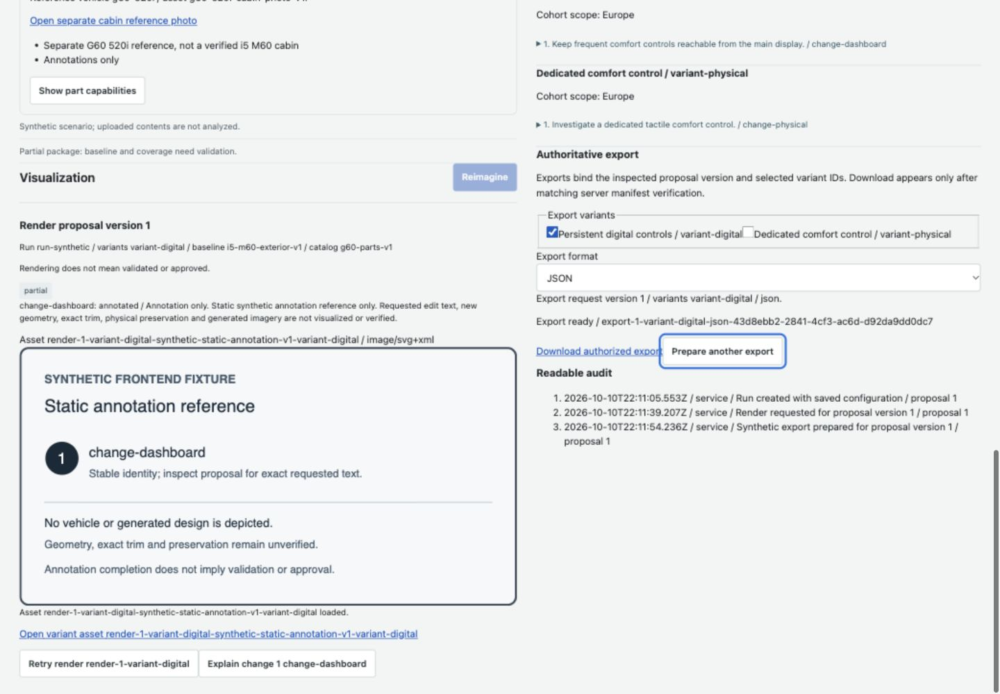
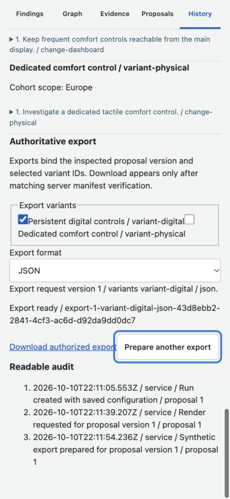

# Combined frontend verification

11 October 2026. Integration preserves the user's frontend base `97b71221ecb62385f5d43632c406165c6d1da690`, including onboarding, inline evidence, draft protections and mobile controls. No backend code was changed by this integration.

Packages merge into `frontend` in dependency order: F1 #4, F2 #5, F3 #6, F4 #7, F5 #8, F6 #9. Merge commits and final clean-checkout/browser evidence are appended after the final merge.

Integration gates: F1 94 tests; F2 157; F3 225; F4 350; F5 393. Every gate passed full frontend tests, typecheck and production build, with separate review. Protected API render assets and export downloads now fetch authoritative bytes with runtime authorization, bounded cancellation, retry, exact identity guards and revocable blob URLs. Public signed links remain direct. Pointer-opened New run dialogs close before restoring focus.

The previous backend-501 statements describe the earlier inspected ref. The current merged base includes implemented backend routes; shared DTO/scenario schemas remain compatible. No backend listener was reachable on port 8000 and no backend was started. HTTP harness evidence is synthetic frontend integration evidence, not deployed analysis, research or generation acceptance. Research dates, variant limits, historical research/count content, preservation validation and unsupported vehicle assets remain the ledger's explicit external dependencies.

## Final merged branch gate

All six PRs are merged. Merge commits: F1 `88b1d79702b6dee8a7f0d0f42a472295b00f792e`; F2 `22858aac82fc198e04be99861225b5348ebf9ee8`; F3 `3e48676c0fb73d6210d5815a3883613e0fadfb87`; F4 `5fa9124193b0b07519563fc1ac0c50dd33dadc55`; F5 `4212b5c7fce2c7371d7ec78101bfbe07dd644b16`; F6 `9b4fd60a5ac6519d6d5a55471135acd73384f313`.

A separate managed clean checkout of merged `9b4fd60` ran `npm ci` (124 packages, zero reported vulnerabilities), `npm test -- --reporter=json --outputFile=/tmp/frontend-combined-clean.json` (**435 pass, zero fail, 36 files**), `npm run typecheck`, and `npm run build` successfully. Production build transformed 1,939 modules. No local secrets/configuration were required. `npm run dev:harness -- --port 5189 --strictPort` started successfully. Available PR GitGuardian checks passed; no frontend CI workflow is configured. Diff outside frontend application/documentation against the user's starting base is empty.

Fresh native WebKit checks on the combined branch: public fixture access, multipart synthetic PDF upload, Start run onboarding, saved configuration, inline exact-source evidence, version-bound Reimagine partial result/static annotation asset, immutable history and ready authoritative export link. Pointer-opened New run cancellation restored actual focus to New run. Desktop 1440×1000 and mobile 390×844 both had page scrollWidth equal viewport width. Screenshots capture ready version-1 export; automated HTTP UI tests separately verify edited version-2 export and returned bytes. Hosted exterior again reported its device/model weight limitation; no successful hosted geometry-render claim is made. Viewport override reset after checks.

The final documentation-only commit records this evidence; application/test code remains identical to the verified F6 merge. Original checkout is fast-forwarded without resetting unrelated user files.
