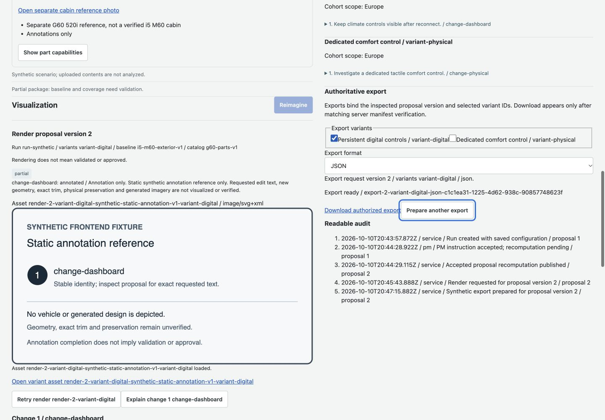
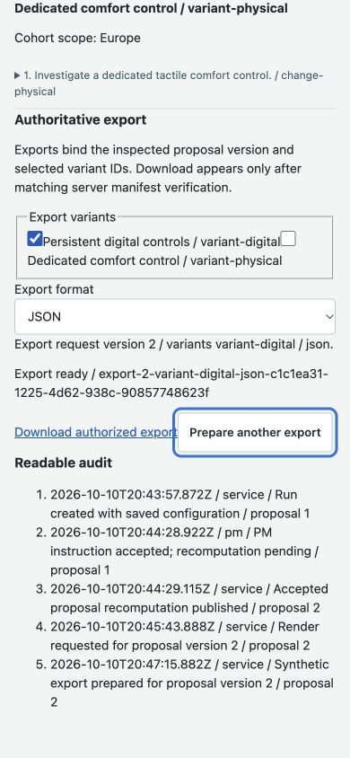

> Historical package evidence below describes the original F6 gate. Current merged-branch evidence and backend availability supersede it in [COMBINED-VERIFICATION.md](COMBINED-VERIFICATION.md).

# F6 integration and acceptance verification

10 October 2026. Scope: frontend application, tests, fixtures and documentation only. Branch `codex/frontend-f6` is stacked on verified F5 `eca4e883077de5dc33d17dbfaa1d6eef62081bdc`. Final application/test implementation: `34c1d1e`; later commits update this evidence and PR references only.

## Behavior and evidence

The opt-in frontend HTTP harness runs the real application adapter over native HTTP and SSE. It validates published request/response schemas without coercion, rejects malformed transport output, isolates the ten scenario workspaces, checks fixture authorization, streams actual uploaded source bytes, and serves API-authorized versioned export bytes. It supports deliberate HTTP failures, interrupted commands, duplicate/replayed events and expired cursors. It is development/test infrastructure, not a backend service implementation. The production build excludes the middleware. A persistent banner explicitly identifies synthetic HTTP fixtures before connection and inside the workspace.

The ten named shared scenarios are mapped to specific assertions in [the ledger](ACCEPTANCE.md). Network acceptance adds a complete upload/source/run/finding/evidence/edit/render/immutable-proposal/export/download chain. The real-mode UI test completes upload → finding → exact evidence → proposal version 2 → partial Reimagine → numbered explanation focus → immutable version 2 → authorized export, then checks returned artifact identity/content. Successful fixtures do not prove live analysis or generation.

Recovery checks cover 401/403 stopping, denied original-source recovery, 503 research retrieval preserving findings, an interrupted accepted instruction retried with the same idempotency key/body, actual duplicate/older SSE frames, replay and 410 reconciliation. Earlier package tests cover bounded requests, exact-version stale drafts, late render isolation, disposal/polling cleanup and unavailable assets.

Keyboard acceptance found two graph focus gaps: asynchronously removed relationship controls and nodes displaced beyond progressive detail. The final implementation tracks focused controls and moves focus to the retained selected detail or graph heading only when that control disappears. Search focus stays unchanged; graph identity is never substituted. Native reload testing found spatial selection reconciled before restored catalog/snapshot data arrived. Reconciliation now waits for authoritative data, and the real-mode remount test proves Body selection and an unsaved versioned draft survive startup.

## Executed commands

A separate managed clean checkout at `34c1d1e` had no tracked changes and no `frontend/.env.local`. Node `v25.9.0`, npm `11.12.1`.

```sh
cd frontend
npm ci
npm test -- --reporter=json --outputFile=/tmp/f6-clean-final.json
npm run typecheck
npm run build
npm run dev:harness -- --port 5188
```

- `npm ci`: 124 packages installed; 0 reported vulnerabilities.
- Vitest: **387 tests pass, 0 fail, 34 files**. Clean report `/tmp/f6-clean-final.json` (ephemeral local evidence); the same suite also passed in the development worktree before the final selection regression, with the affected 36 App/network tests rerun after that fix.
- Typecheck: pass. Production TypeScript/Vite build: pass, 1,938 modules; largest client chunk about 378 kB before gzip.
- `git diff --check`: pass at the final package gate.
- `npm run test:acceptance` selects network, real-mode UI and accessibility acceptance; the full suite above includes these tests plus harness boundary and all F1–F5 regressions.
- `npm run dev:harness` started from the clean checkout without secrets or a local environment file and served the browser flow below. The asset-failure run used `FRONTEND_HARNESS_FAIL_ASSET_ONCE=1` before the command.

## Native browser checks

Codex in-app browser / WebKit, actual HTTP harness at `http://127.0.0.1:5188/`, public fixture token `harness-token`, workspace `standard_autonomous`. Desktop 1440×1000, mobile 390×844. Temporary viewport overrides were reset afterward.

- Synthetic banner visible before entering access; incorrect fixture token produced an access error, then changing access and reconnecting restored the catalog.
- Actual multipart upload and autonomous run completed; saved source, baseline/catalog IDs and configuration remained inspectable.
- Graph keyboard filtering showed an empty result honestly; exact finding navigation opened evidence. Source dialog displayed `dashboard-E1`, `synthetic-source-v1`, Feedback row 12/cell A12 and scope/applicability. Escape returned focus to the originating source button on desktop and mobile.
- Proposal edit was accepted separately from recomputation, then SSE published version 2. Run ID, selected tab and unsaved draft survived re-entering access after reload. A second final reload retained selected **Body** (`aria-pressed=true`) and `Unsaved final reload draft.` after catalog/snapshot restoration.
- Version 2 Reimagine progressed from queued to partial. The first actual annotation image request deliberately returned HTTP 503; preview failure retained baseline, outcomes and explanation. Keyboard retry loaded the same static SVG (`naturalWidth=960`) without creating a render command or altering its authorized URL.
- Keyboard numbered explanation focused the exact change container and displayed version 2 / `variant-digital` / `change-dashboard`, edited text, exact sources and explicitly current finding counts.
- History inspected immutable proposal version 2. Export progressed from queued to ready and exposed the API-returned authorized link for that version and variant. Actual exported JSON/version/content are verified by the HTTP/UI tests, not inferred from visible UI state.
- Desktop/mobile page `scrollWidth` equaled viewport width (1440/390); visually checked explanation, source dialog and export controls, long IDs and wrapping. Screenshots below record final exact-version export. Loading, empty, network/asset failure and recovery states were exercised; remaining permutations are covered by automated component/lifecycle tests.
- Reduced motion is verified through live preference changes in SDK test doubles (camera duration 0 versus 0.22) and shipped CSS media rules. No claim of changing the browser's OS motion preference or testing a physical mobile device is made.
- The hosted exterior SDK connected, but its embedded viewer reported “Model is too heavy for your device and can not be rendered properly.” The local preview and keyboard component list remained available. This is an external hosted asset/device limitation, not successful 3D render evidence.





## Separate review and external acceptance

Independent sub-agents reviewed the harness/API boundary, complete UI path, schema/scenario assertions and accessibility/failure paths. Actionable graph focus findings were fixed with failing-then-passing regressions. Final focus and startup-selection fixes received separate read-only review; no actionable findings remain.

Fresh read-only fetch: `origin/backend` is `12c1ade5dd3829cd6f48d7336091f954207f161f`. `git diff 2d0483fd4d9bb4f95da5b8212db5d78b24a5ac46..origin/backend -- contracts` is empty; pinned frontend schemas remain current. Local `127.0.0.1:8000/health` refused connection. The inspected backend still returns `501 not_implemented` for analysis resources, instructions/checkpoints, rendering/export and immutable proposal history. No backend code was modified or started.

Live upload analysis, external research, service persistence/replay, original-file authorization and generation/export therefore require deployed backend acceptance. Contract gaps remain DATES (F3.02), LIMITS (F3.06), research rerun (F3.03/F3.07), HISTORICAL counts/research (F4.05), PRESERVATION (F5.03), and unavailable/unverified ASSETS (F2.08/F5.01/F5.08). Frontend presents these limitations and uses supported retrieval or list/photo fallbacks; it does not fabricate unavailable data, geometry, mappings or endpoints.

[F6 #9](https://github.com/indkhan/vehicle-requirements-ai/pull/9) is open and attached to the implementation chat, based on `codex/frontend-f5`. F1–F6 PR checks passed GitGuardian Security Checks. No frontend CI workflow is configured; local clean-checkout tests/typecheck/build are the frontend verification evidence. F6 opening head `18ba54c36b47c535417e216e4c9bc684cf50676b` passed this check at `2026-10-10T21:00:06Z`; the final reference-only documentation commit is checked again before delivery. No PR is merged.
