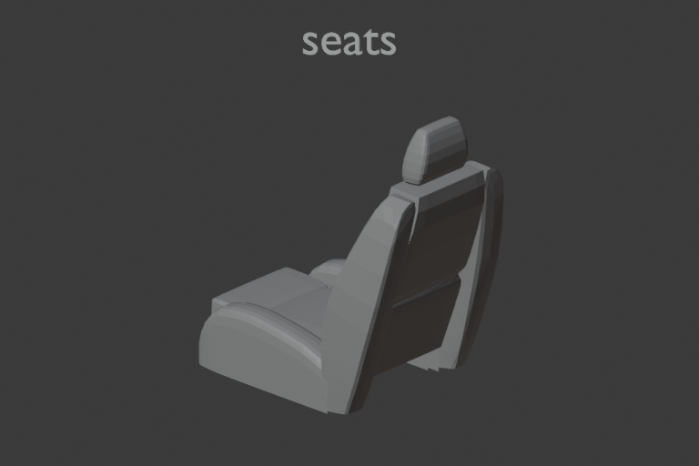
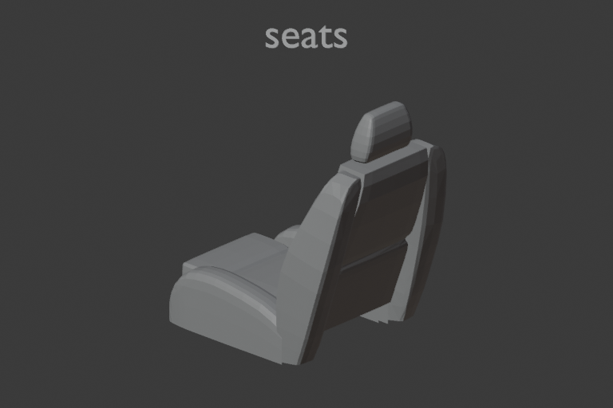
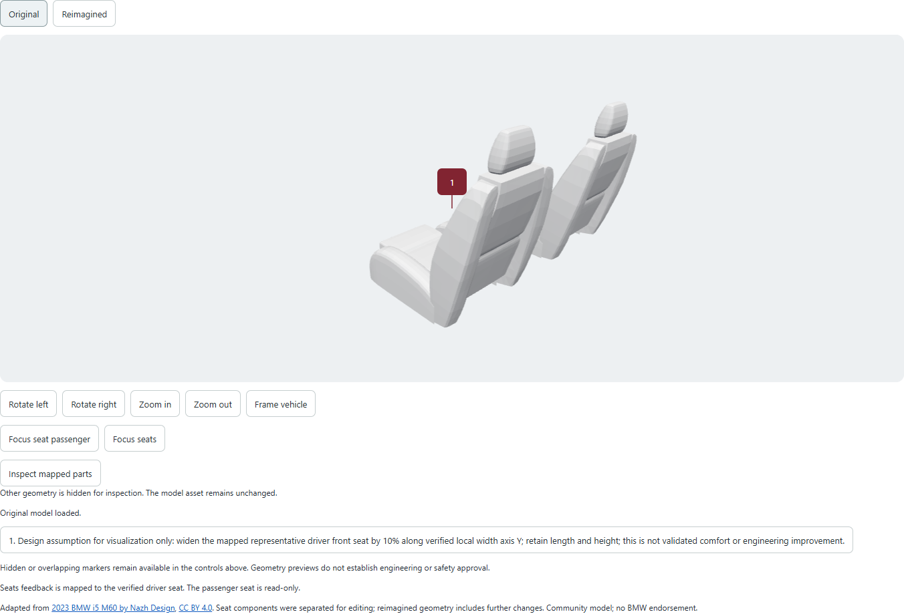
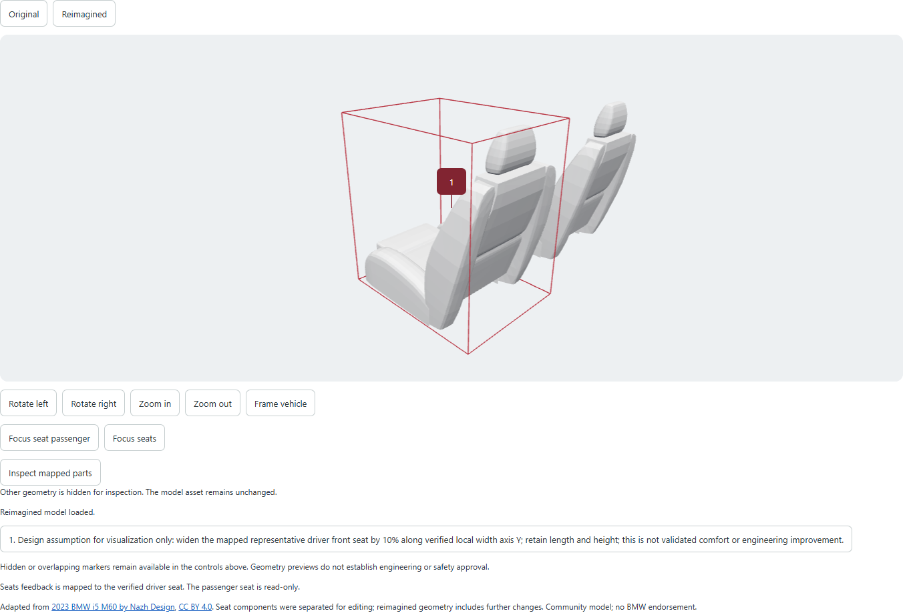

# Reimagine verification

Integration base: `origin/main` at `b22f7ab`; isolated worktree branch
`codex/vehicle-reimagine`. The existing `origin/frontend` experience was already
included in this base. The original checkout and its uncommitted work were not
modified. No merge or deployment was performed.

## What is exercised

The application retains its ingestion, saved proposal review, evidence,
Temporal jobs, workspace ownership and authorized asset delivery. The new
private renderer persists a version-bound manifest; a separate worker runs
trusted Blender operations on job-specific geometry, independently measures
the result and fingerprints unaffected meshes. The Responses editor inspects
the verified catalog, proposes bounded operations, and reviews actual labelled
renders. Corrections and retries reuse committed stages. Geometry produced,
visual adherence and engineering validity remain separate outcomes.

The browser loads self-contained original/candidate GLBs with exact scene and
part identities. Tags use mesh-local anchors; numbered result markers link to
saved change explanations and customer evidence. Switching versions preserves
the camera and restores the correct original anchors. Unmapped feedback,
unsupported changes, failed jobs and stale proposal bindings stay visible.

## Real asset checks

The original BMW was downloaded through the signed-in user's official
Sketchfab Download button. Source provenance and replayable preparation are in
[the asset record](reimagine-assets.md). The final baseline is 21,742,800 bytes;
the complete source geometry is retained without a lossy simplification. Large
source, Blend and GLB files remain outside Git under private local storage.

An offline Blender test widened the independently separated driver seat by
10%: local width 0.554572597 to 0.610029817 m, with identical length/height.
Independent parsing of exported GLB POSITION buffers verified exact unchanged
coordinates in the other 34 meshes. This verifies geometry, not comfort,
physical mounting, exact collision clearance or manufacturing validity.

| Original seat | Measured wider seat |
| --- | --- |
|  |  |

Images derive from **2023 BMW I5 M60 by Nazh Design**, [CC BY 4.0](https://creativecommons.org/licenses/by/4.0/).
Front seat components were separated and resized for design exploration.
[Source model](https://sketchfab.com/3d-models/2023-bmw-i5-m60-207fd872d28b4cafa7fefe061ae98e26).

## Live application verification

Actual services ran in an isolated PostgreSQL/Temporal development stack,
FastAPI on 8101, frontend on 5175, private renderer on 8090, and a separate
bounded Windows Blender worker. Existing application services and data were
left intact. Feedback workbooks were explicitly synthetic; vehicle geometry
was the actual downloaded BMW.

T3's collaborative browser verified uploading the original two-record fixture,
real provider extraction, saved proposals and the honest missing-asset failure.
The desktop browser host then disconnected, returning an explicit unavailable
error; headless installed Edge through Playwright was used for subsequent
browser checks. It verified the actual baseline GLB, rotation/zoom, visible
part-local tags in the inspection view, customer evidence and reload/reconnect.

A second workbook requested wider cushion/backrest surfaces. Upload, live
extraction, saved selection, evidence tags and Reimagine submission passed.
The first geometry attempt failed before a paid editing call because the
Windows environment sanitizer omitted uppercase `SYSTEMROOT`, causing SSL
initialization errors and an NVIDIA render crash. Adding only the required OS
variable fixed the same restricted-environment render; a regression asserts
application credentials remain absent. The same job was retained for retry.

The same-job retry completed with an honest unsupported result: the editing
model produced no dimension plan for the provisional wider-seat suggestion.
The browser's expected-success assertion therefore failed; no fake candidate
was shown. A PM then saved version 2 with an explicit, labelled visualization
assumption: widen the representative driver seat 10%, retaining length/height.
The browser verified that unsaved changes disabled Reimagine and that the old
result became stale. Exactly one new version-bound job was submitted.

That live Responses job inspected the part, proposed the measured resize,
exported the actual BMW and passed matching-view vision review with no
correction rounds. Its independent GLB check confirmed width 0.554572597 to
0.610029817 m, identical length/height, exact unchanged positions in 34 other
meshes and unchanged node transforms. Geometry production and visual review
passed; engineering validity remains `not_assessed`.

The final read-only browser recovery test passed (12.8 seconds): candidate
parsing, interior inspection, numbered marker, evidence source control,
matching-camera Original/Reimagined switching and reload/reconnect. Browser
verification was performed in stages after diagnosing the earlier failures;
the initial single upload-to-success test did not pass uninterrupted.

| Browser original | Browser reimagined |
| --- | --- |
|  |  |

## Checks and limitations

- Final full backend suite: 253 passed, 3 skipped in the Linux service container
  (108.27 seconds; two harmless cache warnings from the read-only repo mount).
  The skips require Blender/local preparation; separate Windows checks ran
  those paths against the actual installed Blender.
- Geometry checks: 16 passed, including two real Blender executions.
  After final review, 15 focused geometry/recovery tests passed, including a
  new fault-injection check for atomic retry queue/deduplication commits.
- Asset preparation checks: 5 passed, including real connected-component
  separation and preservation checks.
- Ruff, format, mypy (43 modules), generated contract consistency and
  `git diff --check` passed.
- Frontend: 474 tests passed, 1 opt-in live-backend test skipped; 49 test
  files passed and 1 skipped. Typecheck and production build passed.
- Real browser baseline rotation/tags/evidence/recovery, saved-edit guards,
  stale-result warning and final candidate comparison/recovery passed.
  The unsupported-result browser check also passed (5.7 seconds), retaining
  the original model and evidence without showing a generated success.

An intermediate attempt copied tests to `/tmp` without their repository-relative
fixtures and was aborted after path-related failures. The final full run used
the complete repository at its correct paths and passed as reported above.

Live editing/vision tests use the user's $10 total allowance and explicit
bounded calls; no component-generation provider purchase was made. The
configured Responses model is `gpt-6.1-sol`. Private job records retain model,
response/tool IDs, interpretations, usage, measurements and reviews without
credentials. Normal tests do not submit live provider jobs.
The successful BMW editing job made three planning Responses calls and one
vision call; its recorded total was 12,841 input and 373 output tokens.
Earlier bounded extraction, fixture and unsupported-plan calls also ran.
No exact billing invoice was available; these were bounded tests under the
authorized allowance, not a general permission for ongoing paid jobs. The
one-job live worker exited after completion, and paid editing remains disabled
by default.

Supported actual BMW editing is currently a bounded whole-mesh resize of one
representative front seat, including its headrest. Passenger geometry is
read-only. Dashboard/display mapping, entirely new shapes, certified mounts,
arbitrary prose preservation constraints and exact surface collision checks
remain unsupported or unassessed. Meshy, Tripo and Rodin APIs were evaluated,
but no funded generation credentials are configured. A generation integration
and verified additional component mappings are required before those cases can
be demonstrated. The PR remains draft for these product gaps.
