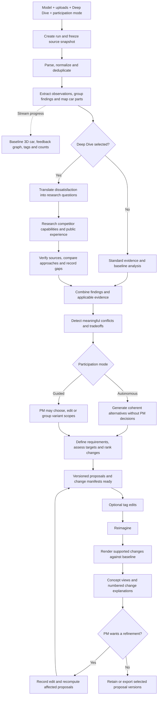

# Final plan: parallel frontend and backend delivery

This is the shared entry point and integration agreement. The implementation work is split into two team plans:

1. **[Frontend and 3D team](frontend_plan.md):** workspace, car/graph visualization, Deep Dive panels, edits, concept views, scene catalog and renderer implementation.
2. **[Backend team](backend_plan.md):** ingestion, findings, Deep Dive research, variants, requirements, API, jobs, persistence, traceability and renderer orchestration.

Both teams must use the shared contract below. It is the implementation target, not a claim that an API already exists. Deferred capabilities remain in [backlog.md](backlog.md). These documents supersede `first_plan.md`.

## 1. Product objective and scope

Build a reusable application that turns uploaded vehicle evidence into findings, proposed customer requirements, alternative change sets and explainable concept views.

The primary experience is autonomous: the PM chooses the vehicle, uploads evidence, selects run settings and receives completed proposals without making intermediate decisions. The PM can inspect, edit and refine the result. Guided participation is an optional mode of the same pipeline.

The automotive scope is **step 1: market research and needs analysis**, and **step 2: product planning**. The output is a customer requirements proposal and visual concept. Detailed vehicle engineering, homologation, production workflows, pricing and cost calculations are outside this scope. Rough effort or attainability assessments can support decisions when their basis and uncertainty are explicit.

Optimize for a strong startup product suitable for BMW. There is no fixed staffing or calendar constraint; sequence work by dependencies and quality gates.

## 2. Confirmed product decisions

- Autonomous proposal completion is the default; guided PM checkpoints are secondary.
- Initial uploads support partial packages, multiple files and multiple regional populations for the selected vehicle.
- Deep Dive is available alongside model selection and uploads before creating a run.
- Findings populate the feedback graph and tags on the baseline car while analysis proceeds.
- Negative feedback volume drives red intensity; the UI also receives denominators and coverage information.
- Material differences in preferences can produce separate proposal variants. The PM can choose or regroup them.
- Evidence, findings and history are available through tags, panels and toggles rather than mandatory separate workflow screens.
- There is no standalone regional or cross-model comparison workspace. Regional conflict analysis remains necessary, and Deep Dive adds competitor comparisons inside relevant evidence.
- The PM can edit, remove or add proposed changes before Reimagine and refine results afterward.
- The visualization service receives explicit changes for supported parts and preservation constraints for other parts.
- Numbered changes explain the original state, proposed state, rationale and evidence.
- Source refresh, continuous monitoring and automatic reconsideration thresholds are deferred. PM-driven reruns on the current evidence remain in scope.

### Working defaults

These are implementation defaults, not BMW-prescribed rules:

- **Reimagine remains an explicit button.** Analysis and proposal generation complete without PM decisions; the button launches visualization. This follows the latest detailed interaction description. Automatic visualization after analysis remains an unresolved product choice, not a required checkpoint.
- Deep Dive defaults to off and runs automatically when selected at creation.
- Generate a small set of coherent alternatives, provisionally up to four initially. Preserve unresolved conflicts and support additional branches on request rather than silently discarding them.
- AI can propose measurable targets. Each target records its basis and maturity; unsupported numbers do not become validated requirements merely because a run completes.

## Whole-application flow



The graph and tags update alongside analysis; rendering the feedback graph is not a backend processing dependency. Research failures produce explicit partial results or gaps. Renderer failures preserve completed proposals and can be retried independently.

## Ownership and parallel working agreement

| Area | Owner | Other team's dependency |
|---|---|---|
| UI and API client adapter | Frontend | Published API payloads, errors and events |
| Baseline assets, scene/part catalog | Frontend/3D | Backend consumes stable semantic part IDs |
| Renderer implementation and stub | Frontend/3D | Backend submits manifests and consumes results |
| API, auth, uploads, storage and run state | Backend | Frontend consumes API and events |
| Counts, findings, research, scores and proposals | Backend | Frontend displays authoritative results |
| Job orchestration, render retries and audit | Backend | Renderer supplies version-bound results |
| Shared contract and fixtures | Backend maintains; both review | Changes land before either side depends on them |
| End-to-end acceptance | Joint | Both execute the same scenarios |

Suggested implementation ownership is `frontend/`, `backend/`, `renderer/` and `contracts/`. These are planned boundaries, not existing application directories. Keep team-specific work in its owned area; coordinate shared package files, root configuration and contract changes explicitly.

The frontend starts with a mock API; backend starts with a stub renderer. Mocks and stubs must consume the same schemas and IDs as the real services. Integrate the first upload-to-finding path early while both teams continue their remaining work.

## Shared integration contract

### Contract rules

- Use `/api/v1` for application endpoints and `contract_version: "1"` in snapshots and events.
- IDs are opaque strings. Do not derive meaning from a display label, array position or filename.
- Timestamps are UTC ISO 8601 strings. Null means unknown; it is different from zero, false or an empty collection.
- Lists with potentially large results are paginated; source and asset bodies are retrieved separately through authorized URLs.
- Wire field names use snake_case. Scores, counts and intensity values are calculated by backend.
- Mutating commands use an `Idempotency-Key`. Repeating the same key and body returns the same resource/result; reusing a key with a different body is rejected.
- Commands that change a proposal name `base_proposal_set_version`. A mismatch returns `409 stale_version` and the current version; no partial mutation is committed.
- The server identifies the actor from authentication and checks run/source access. The frontend never supplies authoritative audit identity.
- Each response includes a request ID for diagnosis. Errors use `{code, message, retryable, field_errors, current_version}` with inapplicable fields null or empty.
- Backend publishes OpenAPI/JSON schemas and examples in `contracts/` before feature work relies on them. Both teams run schema validation against the same fixtures. Additive compatible changes stay in v1; breaking changes require a coordinated version change.

### Upload and run creation

The initial upload flow is separate from analysis. `POST /api/v1/uploads` accepts multipart files and returns source IDs, detected type and `ready` or `rejected` status with a reason. Infrastructure can later use signed direct uploads behind the same logical contract; do not independently implement a different flow on each side.

A rejected file can be removed and the remaining ready sources used as a partial package. Run creation takes source IDs owned by the authenticated workspace; it does not take browser-local paths.

Example create-run body, using synthetic IDs:

```json
{
  "vehicle_id": "vehicle_demo",
  "baseline_asset_id": "asset_demo_v1",
  "part_catalog_version": "catalog_demo_v1",
  "source_ids": ["source_demo_1"],
  "market_context": ["US"],
  "participation_mode": "autonomous",
  "deep_dive": {"enabled": true}
}
```

Backend validates catalog/asset compatibility and scope, freezes the configuration, and returns `202` with `run_id`, snapshot URL and events URL. Market labels are hints checked against source contents; they do not manufacture evidence. The backend can choose and record research scope and limits without another PM checkpoint.

### Application operations

All paths below are under `/api/v1`.

| Operation | Request/result boundary |
|---|---|
| `GET /vehicles` | Available vehicle IDs, baseline assets, part-catalog versions and supported capabilities. |
| `POST /uploads` | Multipart uploads; source IDs and per-file status. |
| `POST /runs` | Frozen configuration; run ID and resource URLs. |
| `GET /runs/{run_id}` | Coherent current snapshot, revisions, summaries, resource links, actions and event watermark. |
| `GET /runs/{run_id}/events` | Server-sent events; resume by last event ID. |
| `GET /runs/{run_id}/findings` | Paginated findings; cohort/part filters and server-computed counts for the same scope. |
| `GET /runs/{run_id}/graph` | Paginated/filterable graph nodes and typed edges with resource revisions. |
| `GET /runs/{run_id}/research` | Research status and source-linked bundles by finding. |
| `GET /runs/{run_id}/conflicts` | Conflicts, proposed alternatives and guided checkpoints. |
| `GET /runs/{run_id}/proposals` | Current or requested immutable proposal-set version, variants, requirements and changes. |
| `GET /runs/{run_id}/evidence/{evidence_id}` | Evidence metadata, original locator and authorized access to the source; access is audited. |
| `POST /runs/{run_id}/instructions` | Version-bound edit/add/remove/regroup or request-more-variants command; instruction/job ID. |
| `POST /runs/{run_id}/checkpoints/{checkpoint_id}/continue` | Checkpoint version and selected resolution; resume the matching guided pause. |
| `POST /runs/{run_id}/decisions` | Optional approve/reject/defer/select action, exact variant/version and rationale; recorded decision ID. |
| `POST /runs/{run_id}/renders` | Exact proposal-set version, variant IDs and baseline asset; durable render request ID. |
| `GET /runs/{run_id}/renders/{render_request_id}` | Render status, exact input versions, assets and per-change outcomes. |
| `POST /runs/{run_id}/renders/{render_request_id}/retry` | Retry failed work for the same immutable input with recorded attempt history. |
| `GET /runs/{run_id}/history` | Paginated audit events and version references. |
| `POST /runs/{run_id}/exports` | Exact proposal/variant versions and format; export job ID. |
| `GET /runs/{run_id}/exports/{export_id}` | Export status, version manifest and authorized download URL when ready. |

Long commands return `202` with a stable command/resource ID. Expose result state through snapshots/events and resource queries. A proposal instruction contains a typed operation (`edit_change`, `remove_change`, `add_change`, `edit_target`, `regroup_variants` or `request_more_variants`), target IDs, base version, the changed fields and optional free-text intent. Backend validates and records it before processing.

### Shared objects and required fields

| Object | Required integration fields |
|---|---|
| Run snapshot | `run_id`, `contract_version`, `config`, `analysis_status`, `stage`, `revision`, `last_event_sequence`, `current_proposal_set_version`, `available_actions`, `warnings`, resource links. |
| Evidence reference | `evidence_id`, `source_version_id`, `source_kind`, typed `locator`, `scope`, `excerpt`, applicability/limitations. Source kind distinguishes uploaded material from external research. |
| Finding | `finding_id`, `revision`, `title`, `customer_need`, `part_ids`, `cohort_ids`, `supporting_evidence_ids`, `opposing_evidence_ids`, `counts`, `coverage`, `provisional`. |
| Part aggregate | `part_id`, scope/cohort IDs, distinct total and negative records, negative share or null, `intensity_value`, `intensity_scale_id`, low-evidence flag, provisional flag. |
| Research bundle | `research_id`, `finding_id`, `status`, competitor scope, claims with `fact`/`opinion`/`inference` type, citations, counterevidence, candidate approaches, recommendation and gaps. |
| Conflict/checkpoint | Stable ID, version, finding IDs, scoped alternatives, rationale, resolution status; checkpoint adds allowed actions and current wait state. |
| Proposal set | Immutable `proposal_set_version`, run/source/research snapshot references, scoring-policy version, variant list and unresolved conflicts. |
| Variant | `variant_id`, title, cohort scope, assumptions, requirement/change references and relation to other variants. |
| Requirement/change | Stable IDs and versions, origin (`ai`/`pm`), outcome, part IDs, before/after, evidence/finding references, metric/target/validation, target maturity, score/factor rationale, uncertainty and decision state. |
| Graph edge | `edge_id`, `from_id`, `to_id`, typed relationship and provenance; nodes carry entity type and stable ID. |
| Render result | `render_request_id`, exact input version/variant IDs, status, asset references, per-change outcomes and failure/unsupported reasons. |

Backend specifies field types and enums in the schema artifact before either team creates divergent representations. Exact quote lengths and source bodies are not embedded in every progress event.

### States and UI behavior

Analysis and rendering are separate resources. A successful proposal set can have several completed, partial or failed render requests.

| Resource | Wire states | Required UI behavior |
|---|---|---|
| Analysis | `queued`, `processing`, `waiting_for_pm`, `proposals_ready`, `failed` | Ordinary conflicts never enter `waiting_for_pm` in autonomous mode. Display repairable input failures separately from uncertainty. |
| Research | `queued`, `searching`, `checking`, `ready`, `partial`, `unavailable` | Off is expressed by disabled run configuration and no research jobs. Partial/unavailable research need not fail analysis. |
| Render | `queued`, `rendering`, `succeeded`, `partial`, `failed` | Preserve proposals and any useful assets on partial/failure; show exact proposal versions. |
| Export | `queued`, `processing`, `ready`, `failed` | Download only the completed exact-version artifact. |

An accepted edit can move analysis back into `processing` while previous proposals remain inspectable. Backend provides `available_actions` such as `edit`, `continue_checkpoint`, `reimagine`, `retry_render` and `export` rather than forcing UI to infer all permissions from stage names.

### Progress and reconnection

Use a single server-sent event stream per run. Events are persisted with strictly increasing per-run sequence numbers. A snapshot includes the sequence through which its state is coherent; the client then consumes events after that watermark.

Example event envelope:

```json
{
  "contract_version": "1",
  "event_id": "event_demo_17",
  "sequence": 17,
  "run_id": "run_demo",
  "type": "research.updated",
  "occurred_at": "2026-10-10T12:00:00Z",
  "resource": {"type": "research", "id": "research_demo", "revision": 3},
  "proposal_set_version": null
}
```

Event types include `analysis.updated`, `findings.updated`, `graph.updated`, `part_counts.updated`, `research.updated`, `conflicts.updated`, `checkpoint.created`, `proposals.ready`, `render.updated`, `export.updated` and `audit.appended`.

Events invalidate the referenced resource; frontend fetches its current revision and ignores older/duplicate sequences. Do not apply a graph event as an unversioned patch. On reconnect use the event ID as the replay cursor. If the replay window is unavailable or a gap is detected, fetch a fresh snapshot and resume from its watermark. Snapshot polling is an acceptable fallback when the event transport is unavailable.

### Renderer contract

Frontend/3D implements this server-side adapter; backend owns its calls, retries and result persistence. Use a versioned adapter contract regardless of generation provider.

- `POST /renderer/v1/jobs`: backend-provided `render_request_id`, run/variant IDs, proposal-set version, baseline asset/catalog version and change manifest. Returns accepted job ID and status.
- `GET /renderer/v1/jobs/{job_id}`: returns current status and exact matching IDs/versions, assets and per-change outcomes. Backend polls this endpoint initially; callbacks can be added later without changing the application UI contract.
- Repeated submission for the same request ID/input must return the same job. A mismatched body for that ID is rejected.
- Manifest changes include `change_id`, `part_ids`, `proposed_outcome`, `visual_instruction`, `preserve_constraints` and `evidence_ids`.
- The versioned scene catalog maps semantic part IDs to parent parts, mesh/anchor references and supported modification/annotation capabilities.
- Each requested change returns `rendered`, `annotated`, `unsupported` or `failed`, plus reason and asset references where relevant. Partial success is explicit.
- Service authentication and asset access must be configured between backend and renderer; the browser does not receive provider/service credentials.

Agree these IDs and capabilities before either team hardcodes a scene or manifest. Backend can use the stub while frontend/3D develops real rendering.

## Fixtures both teams use

Create `contracts/` as the first shared implementation deliverable: API schema, renderer schema, sample scene catalog and synthetic request/response/event fixtures. Backend maintains the API fixtures; frontend/3D maintains the scene and renderer fixtures. Both review changes.

Include these named scenarios:

1. `standard_autonomous`: a partial upload package reaches proposals with no PM wait.
2. `deep_dive_success`: research augments the evidence without changing uploaded-feedback counts.
3. `deep_dive_partial`: a timeout exposes a gap and proposals still complete.
4. `guided_conflict`: a checkpoint supports regional regrouping and resumes once.
5. `duplicate_uploads`: repeated records do not increase counts.
6. `pm_edit_stale`: the server rejects an old base version; the UI retains the draft.
7. `render_partial`: one change renders and another is unsupported.
8. `render_late`: an old result arrives after a newer proposal and cannot replace it.
9. `reconnect`: duplicate/replayed events or an expired cursor recover a coherent view.
10. `versioned_export`: the download identifies the selected proposal and evidence versions.

Keep IDs and version references consistent across each fixture's upload, graph, finding, proposal, render and export. The frontend mock replays these fixtures; backend tests validate its actual responses against the same schemas. Synthetic examples must be labeled and must not imply BMW approval.

## Parallel milestones and merge checklist

### Shared start

- Land schemas, fixture IDs, catalog/part IDs, error model and local configuration conventions first.
- Provide separate frontend mock mode and backend renderer-stub mode.
- Agree an API base URL and same-origin proxy or explicit development CORS policy.
- Each team owns its dependencies/configuration under its area; shared root changes are coordinated.

### First integration, while implementation continues

- Run the frontend against the real API for upload, create run, snapshot, one finding and an evidence link.
- Verify that a real part ID maps to the agreed scene anchor.
- Backend calls the renderer stub through the final adapter shape.
- Resolve contract mismatches in the shared schema/fixtures before adding local compatibility hacks.

### Complete vertical flow

- Demonstrate standard and Deep Dive runs, autonomous and guided paths, one edit, Reimagine, a numbered explanation and export.
- Swap the renderer stub for the real service without changing the frontend's application API.
- Exercise partial research, partial rendering, stale edits and reconnect behavior.

### Final merge gate

- Both team branches build and their relevant checks pass.
- Shared schemas validate mock fixtures and real API/renderer results.
- A clean checkout can start each service using documented commands and example environment files without secrets.
- The ten joint scenarios pass against the integrated system, not only isolated mocks.
- No UI-only calculations disagree with server counts or scores.
- Versions, source references, part IDs and assets remain aligned from upload to export.
- Unsupported capabilities and deferred items are documented; unfinished placeholders are not presented as live behavior.

Merge shared contracts first, then team-owned changes in small compatible slices. Neither team needs to wait for the other's full feature set. Avoid independently editing the same schema or root configuration and reconciling only at final merge.

## Evaluation and sources

Both teams share the five criteria from [the final evaluation](doc/image6.png): decision/scoring logic, workflow and human roles, traceability, solution quality/usability/feasibility, and innovation/scalability/business impact. There are no supplied numerical judging weights.

Backend provides defensible evidence, proposals and records; frontend makes those explanations and limitations usable. Evaluate both together, including honest gaps and measured reduction in PM work.

The source brief is [more.md](doc/more.md), with [measurable requirements](doc/image4.png), [SMART goals](doc/image5.png), [the process](doc/image2.png) and [lifecycle context](doc/image7.png). Later user decisions govern the autonomous-first product and initial Deep Dive selection. Scope remains lifecycle steps 1 and 2.

This is an implementation plan and integration target. It does not claim that the application or contract artifacts have already been built.
