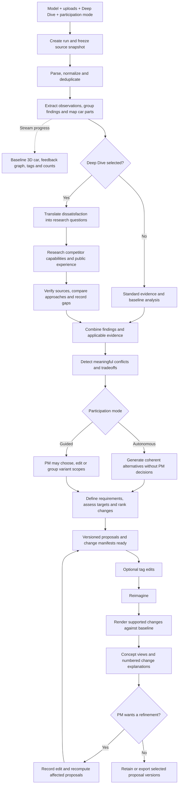

# Final plan: AI vehicle requirements pipeline

**Status:** Consolidated implementation plan, incorporating the latest product decisions and Deep Dive.

This document supersedes `first_plan.md` for implementation direction. It describes the backend and its contracts with the separate UI and 3D team. Deferred capabilities are recorded in [backlog.md](backlog.md).

## 1. Product objective and scope

Build a reusable application that turns uploaded vehicle evidence into findings, proposed customer requirements, alternative change sets and explainable concept views.

The primary experience is autonomous: the PM chooses the vehicle, uploads evidence, selects run settings and receives completed proposals without making intermediate decisions. The PM can inspect, edit and refine the result. Guided participation is an optional mode of the same pipeline.

The automotive scope is **step 1: market research and needs analysis**, and **step 2: product planning**. The output is a customer requirements proposal and visual concept. Detailed vehicle engineering, homologation, production workflows, pricing and cost calculations are outside this scope. Rough effort or attainability assessments can support decisions when their basis and uncertainty are explicit.

Optimize for a strong startup product suitable for BMW. There is no fixed staffing or calendar constraint; sequence work by dependencies and quality gates.

## 2. Confirmed product decisions

- Autonomous proposal completion is the default; guided PM checkpoints are secondary.
- Initial uploads support partial packages, multiple files and multiple regional populations for the selected vehicle.
- Deep Dive is available alongside model selection and uploads before creating a run.
- Findings populate the feedback graph and tags on the baseline car while analysis proceeds.
- Negative feedback volume drives red intensity; the UI also receives denominators and coverage information.
- Material differences in preferences can produce separate proposal variants. The PM can choose or regroup them.
- Evidence, findings and history are available through tags, panels and toggles rather than mandatory separate workflow screens.
- There is no standalone regional or cross-model comparison workspace. Regional conflict analysis remains necessary, and Deep Dive adds competitor comparisons inside relevant evidence.
- The PM can edit, remove or add proposed changes before Reimagine and refine results afterward.
- The visualization service receives explicit changes for supported parts and preservation constraints for other parts.
- Numbered changes explain the original state, proposed state, rationale and evidence.
- Source refresh, continuous monitoring and automatic reconsideration thresholds are deferred. PM-driven reruns on the current evidence remain in scope.

### Working defaults

These are implementation defaults, not BMW-prescribed rules:

- **Reimagine remains an explicit button.** Analysis and proposal generation complete without PM decisions; the button launches visualization. This follows the latest detailed interaction description. Automatic visualization after analysis remains an unresolved product choice, not a required checkpoint.
- Deep Dive defaults to off and runs automatically when selected at creation.
- Generate a small set of coherent alternatives, provisionally up to four initially. Preserve unresolved conflicts and support additional branches on request rather than silently discarding them.
- AI can propose measurable targets. Each target records its basis and maturity; unsupported numbers do not become validated requirements merely because a run completes.

## 3. Initial run setup

The starting area contains:

1. Vehicle/model selection and available market context.
2. Uploads for customer feedback, findings, equipment, studies and supporting context.
3. Deep Dive selection.
4. Participation mode: autonomous or guided.
5. Create run.

Create run persists the chosen configuration and a versioned source snapshot. The PM can upload all supplied files, only a subset, or multiple regional files. Derive scope from file contents where supported; filenames alone are not authoritative.

Accept partial evidence and expose its limitations. Unsupported files, unreadable inputs or ambiguity that prevents identifying a usable case need a clear repair path. Ordinary missing evidence and conflicting opinions should not turn into repeated PM questions in autonomous mode.

For Deep Dive, persist the research scope, selected competitor set and research limits. The system can infer a proposed comparable set from the vehicle and market context, record its reasons and proceed without another mandatory PM checkpoint.

## 4. Whole-application flow

The graph and tags update alongside analysis; rendering the feedback graph is not a backend processing dependency. Research failures produce explicit partial results or gaps. Renderer failures preserve completed proposals and can be retried independently.

## 5. Backend pipeline

### Stage 1: create and scope the run

Save the vehicle context, participation mode, Deep Dive flag, uploads and configuration versions. Assign stable run and source-version IDs. Preserve original files and any known derivative, market, generation, period, equipment and software context.

**Output:** run configuration and input manifest.

### Stage 2: normalize evidence

Parse supported workbook and document structures into typed evidence records. Keep original content and exact locators: workbook/sheet/row/cell, PDF page and relevant region, or web passage and URL.

Resolve reusable mappings, detect overlapping uploads and prevent duplicate counting. A repeated ID across unrelated source namespaces must not automatically be treated as the same record. Separate exact duplicates, repeated annotations and genuinely independent feedback.

Preserve missing or uncertain metadata. Germany and Europe may overlap; cohort membership must be explicit so uploading both does not double-count records.

**Output:** normalized, source-linked evidence and a coverage report.

### Stage 3: extract observations, findings and part mappings

Split multi-topic feedback into observations. Identify the customer task, sentiment, requested outcome, reported issue and relevant car area. Group equivalent observations into findings while retaining disagreements, positive feedback and traceable membership.

Use a shared part catalog with stable IDs agreed with the 3D team. Support parent areas, multiple relevant parts and an unmapped/vehicle-wide category. Do not force a physical location for an app or vehicle-wide software issue.

**Output:** finding graph, tags, counts and provisional progress events.

### Stage 4: Deep Dive, when enabled

Research better approaches to the underlying customer need, including cases where customers express dissatisfaction but cannot specify a solution.

1. Convert the finding into a focused research question.
2. Select relevant competitors using vehicle class, market, model year, equipment and customer task.
3. Research actual competitor capabilities and public experience separately.
4. Verify applicability, source support, independence and counterevidence.
5. Assess candidate approaches against the original need and the selected vehicle baseline.
6. Return supported recommendations, alternatives or an explicit validation gap.

**Output:** a versioned research bundle attached to the finding and relevant parts. Section 6 defines the research behavior in more detail.

When Deep Dive is off, skip systematic competitor research. Ordinary bounded checks needed to verify a specific baseline or evidence claim may remain part of standard analysis.

### Stage 5: resolve conflicts and form alternatives

Check whether opposing opinions concern the same capability under comparable conditions. Different equipment, software, usage or regional context may explain the difference without a genuine contradiction.

In autonomous mode, generate coherent alternatives and explain the tradeoffs. In guided mode, surface the conflict so the PM can choose a direction or assign cohorts to variants.

Variants share common findings but retain their own scope, assumptions and changes. For example, a combined China/US variant and a Europe variant are valid only when the supplied evidence supports those assignments. A selected label does not create absent regional evidence.

Avoid the combinatorial explosion of every possible combination. Preserve the conflict ledger even when only a small initial alternative set is generated.

**Output:** variant definitions and recorded conflict resolutions or unresolved tradeoffs.

### Stage 6: define and prioritize changes

Check the applicable product baseline before proposing a new feature. Classify each proposal as a capability change, usability improvement, offering/availability change or preservation of an existing strength. Distinguish a customer requirement from a possible individual fault or service issue.

Use Deep Dive evidence when available to assess possible solutions. Produce measurable customer outcomes with target maturity, validation method, rationale and uncertainties.

Calculate priorities reproducibly from a versioned policy. Keep evidence strength separate from priority. An incomplete factor remains unknown or scenario-based rather than becoming zero.

**Output:** complete proposed requirements and change sets for each variant. Autonomous completion means the proposal set is finished, not that every target is validated or PM-approved.

### Stage 7: Reimagine handoff

Bind the request to exact proposal and baseline versions. Send explicit supported changes, affected part IDs and preservation constraints to the visualization service. Receive status, asset references and per-change outcomes.

Digital experience improvements may require annotations or an interface preview rather than altered geometry. Unsupported visual changes remain understandable in the proposal and are reported explicitly.

**Output:** concept assets linked to exact changes and proposal versions.

### Stage 8: explain and refine

Numbered markers use stable change IDs. Each opens the before/after proposal, why it changed, underlying findings, feedback counts, competitor evidence where used, target maturity and assumptions.

Record PM edits as instructions or proposal changes without modifying source evidence. A PM-added idea without customer support is identified as a PM proposal.

Rerun affected stages using the saved evidence. Preserve prior proposal and render versions. Reuse existing research; a new unanswered question becomes a visible gap rather than triggering deferred background monitoring.

## 6. Deep Dive research and evidence

### Research the need, not only the requested feature

A complaint such as difficulty reaching a frequent control should lead to research into easier ways to perform that task. A customer-suggested solution can be evaluated alongside other approaches.

The result should explain:

- What the uploaded customers struggle with.
- How relevant competitors address the same need.
- What sampled owners, reviewers or study participants appreciate or dislike about those approaches.
- Which improvement best fits the available evidence for this vehicle and market.
- Why alternatives were weaker, and what remains uncertain.

### Separate capability facts from preference evidence

Official manuals and specifications can establish feature availability. Owner feedback, independent reviews and usability studies can inform experience and preferences. Neither source type automatically proves the other claim.

Store the URL, publisher, publication date when known, retrieval time, exact supporting passage, vehicle/market scope and claim type. Distinguish source statements from the system's inferences.

Deduplicate syndicated material, retain counterevidence and inspect whether a claim is firsthand experience or marketing. Treat retrieved content as evidence, never as instructions to the application.

Public feedback is a sample. Describe what the reviewed sources support; do not infer what the entire general public prefers from a few posts. External opinions must not increase uploaded BMW feedback counts or car-tag redness.

### Recommendation rules

Assess candidate approaches using relevance to the original need, applicability, source quality, baseline fit, tradeoffs and plausible attainability. Preserve strengths existing customers value. A competitor feature being popular does not automatically make it appropriate for this vehicle.

Recommend the best-supported approach under the stated criteria. If coverage is weak or contradictory, produce alternatives or a validation proposal rather than inventing certainty.

### Bounded execution

Research status is `queued → searching → checking → ready / partial / unavailable`.

Version the limits for searches, sources, duration and retries. On failure or timeout, preserve useful evidence, report the gap and allow autonomous completion. Every proposal records the research snapshot used. Late results cannot silently change completed proposals or rendered concepts.

This initial research is current scope. Continuous source refresh is deferred in [backlog.md](backlog.md).

## 7. Evidence graph, counts and visual meaning

The logical graph connects:

`source version → evidence → observation → finding → requirement → change → variant`

Findings and changes also reference vehicle parts. Research bundles connect competitor claims and public-experience evidence to the relevant findings. Relations distinguish support, contradiction, applicability and simple mention.

Counts use distinct feedback records after deduplication. Do not call them unique people unless reliable respondent identifiers support that claim. One record mentioning two parts may count once for each part, but only once in the overall distinct total.

Provide the UI with:

- Negative-record count for red intensity.
- Total relevant records, negative share and coverage limits.
- A consistent intensity scale across comparable filters and variants.
- Provisional/final status and low-evidence indicators.
- The source membership behind every count.

Missing mentions are not evidence of satisfied customers. Review frequency is not population prevalence. External evidence has its own provenance and counts.

## 8. Requirement quality and prioritization

Each requirement includes:

- Stable ID and version; applicable vehicle, market/cohort and horizon.
- Clear customer outcome and affected parts or experiences.
- Linked findings, supporting sources and counterevidence.
- Metric, unit, proposed target, conditions, baseline when known and validation method.
- Target origin and maturity: proposed, needs validation, validated or PM-accepted as applicable.
- Priority factors, rationales, score or incomplete-assessment state, and policy version.
- Evidence level, future assumptions, uncertainties and decision/proposal status.

Follow the supplied emphasis on specific, measurable, attainable, relevant and timely outcomes. A numerical target still needs a defensible basis. Concept rendering does not validate engineering feasibility.

The earlier impact/breadth/gap/future-relevance policy at 35/25/20/20 can remain a provisional starting point for evaluation. These weights are not prescribed by BMW. Compare alternatives using the same documented policy and expose sensitivity to uncertain factors.

A source's role matters: equipment establishes availability, feedback describes observed experience, a study provides scoped customer context, and sales/strategy data provides broader context. Do not average incompatible sources into false corroboration.

## 9. Backend architecture and ownership

Use one persisted workflow with reusable stages:

`authenticated API → durable job queue → pipeline workers → relational database + original-file storage`

Workers publish progress, graph updates, tag updates and research status to the UI. A separate visualization service consumes change manifests and returns asset references.

AI interprets evidence, proposes mappings where needed, groups observations, researches needs and drafts alternatives. Application code owns deterministic parsing where supported, IDs, deduplication, counts, score calculation, workflow state, permissions and versioning.

A relational database can store typed graph relationships initially. A graph visualization does not itself require a graph database. Select providers and infrastructure against BMW's deployment constraints and measured quality.

### Main persisted objects

- Run, run configuration and source snapshot.
- Original source, source version and evidence locator.
- Observation, finding and finding membership.
- Part reference and part mapping.
- Research job, research bundle and typed external claim.
- Conflict, variant and cohort membership.
- Requirement version, factor assessment and change version.
- PM instruction, selection/decision and audit event.
- Render request, per-change outcome, asset reference and export manifest.

### Execution and version rules

- Run progression: uploaded → processing, including research when selected → proposals ready → rendering → completed.
- Guided pauses and failures have explicit states; autonomous runs do not pause on ordinary preference conflicts.
- Retries do not duplicate evidence, decisions, variants or render requests.
- Edits and render requests identify exact versions.
- A late render belongs to its original version and cannot replace a newer result silently.
- PM edits invalidate affected downstream work, not the entire source extraction pipeline.
- Access, interpretation, automated choices, changes, scoring and PM actions are auditable with actor, time and rationale.
- AI proposals, PM selections and PM approvals remain distinguishable. Autonomous processing cannot fabricate a human approval.

## 10. UI and 3D integration contract

The other team owns UI layout, 3D assets, navigation and generation. Backend work supplies the following contracts:

| Backend output | UI/3D use |
|---|---|
| Run settings and upload status | Model selection, uploads, Deep Dive and participation controls |
| Graph nodes and typed edges | Growing feedback graph |
| Part IDs, tags, counts and coverage | Car annotations and red intensity |
| Research progress and evidence bundles | Deep Dive progress and competitor evidence cards |
| Conflicts and variant definitions | Optional side-panel choices and separate concept views |
| Versioned change manifests | Reimagine requests and preservation of other parts |
| Stable change IDs and explanations | Numbered before/after/evidence markers |
| Version and audit records | History and exports |

A render request includes `run_id`, `variant_id`, `proposal_version`, `baseline_asset_id`, and changes containing `change_id`, `part_ids`, `proposed_outcome`, `visual_instruction`, `preserve_constraints` and `evidence_ids`.

The renderer returns matching IDs, request status, asset references and per-change success or unsupported-change reasons. Agree stable part IDs and supported visual changes early so both teams can work independently against examples.

## 11. Plug-and-play acceptance

Supported files and a different vehicle case use the same workflow without vehicle-specific code changes. Mapping profiles and part catalogs are reusable configuration. New case labels do not inherit another case's evidence, scores or approvals.

Prove reuse with:

1. An end-to-end primary case from a fresh upload.
2. A second derivative through the same pipeline.
3. A cross-market case with explicit coverage limits.
4. A changed input schema to exercise mapping rather than a hardcoded template.
5. Overlapping regional uploads and duplicate retries.
6. A partial or unsupported-market package that produces honest gaps.

Use supported supplied formats first, then expand adapter coverage. Do not promise arbitrary-file or arbitrary-vehicle support without testing it.

## 12. Build sequence and quality gates

### Gate A: contracts and evaluation fixtures

Agree run semantics, part IDs, renderer contracts, source locators and proposal schemas. Create reviewed fixtures for duplicates, multi-topic feedback, positive feedback, existing-feature complaints, conflicting preferences, missing evidence and market mismatches. Reserve examples for evaluation rather than tuning everything on the demonstration.

### Gate B: ingestion and findings

Implement upload snapshots, normalization, mappings, deduplication, source links, findings, part mappings and progress events. Pass when a fresh upload yields reproducible counts and inspectable findings.

### Gate C: Deep Dive and autonomous proposals

Implement bounded research, claim verification, conflict analysis, alternatives, measurable requirements and reproducible ranking. Pass when unattended runs produce grounded proposals and useful gaps, including when research partially fails.

### Gate D: PM refinement and traceability

Implement optional guided checkpoints, edits, variant regrouping, targeted reruns, exact-version decisions, audit and export. Pass when the complete reasoning and change history can be reconstructed and edits preserve previous results.

### Gate E: Reimagine integration

Connect the renderer using the agreed manifest. Pass when results match requested versions, unsupported changes are reported, unrelated parts have explicit preservation instructions, and retries or late responses cannot corrupt the current result.

### Gate F: reusable product and measured value

Run second-derivative, cross-market and changed-schema cases. Check performance, recovery, access isolation and deployment/integration needs. Compare assisted and manual work on equivalent tasks before claiming time savings or decision-quality improvements.

## 13. Final evaluation mapping

The supplied evaluation defines five criteria without numerical judging weights.

| Criterion | Required proof |
|---|---|
| Decision and scoring logic | Explain factors, source roles, tradeoffs, uncertainty, candidate comparisons and rank changes. |
| Workflow and human decision-making | Demonstrate autonomous completion, optional guided checkpoints, PM interventions and explicit responsibility boundaries. |
| Traceability and auditability | Trace every requirement, change, score and decision to exact evidence and reconstruct versions, rejections and postponements. |
| Solution quality, usability and feasibility | Produce useful, measurable and realistic customer outcomes; integrate clearly with the UI and render service. |
| Innovation, scalability and business impact | Prove reuse, bounded research, robust execution and measured improvement in PM effort or decision quality. |

Honest uncertainty is explicitly rewarded. The demonstration should include an unresolved gap, not only successful recommendations.

Core evaluation scenarios include duplicate uploads, cohort overlap, conflicting regional preferences, uncertain targets, a PM-added unsupported idea, failed research, unsupported competitor claims, duplicate public sources, counterevidence, a nonvisual change and a failed or late render.

## 14. Current scope versus backlog

Current scope includes initial uploads, initial Deep Dive research, autonomous proposals, optional guided participation, PM edits, variants, Reimagine integration, evidence tracing and export.

Deferred capabilities are maintained in [backlog.md](backlog.md): scheduled imports, continuous new-evidence ingestion, source refresh, monitoring, and thresholds for automatically reconsidering requirements. Software-versus-physical-issue trigger thresholds belong to that later work.

## 15. Planning sources

- Latest product decisions in this conversation, including autonomous-first behavior, the UI/3D ownership boundary and Deep Dive at run creation.
- [Mission, scope and deliverables](doc/more.md).
- [Final evaluation criteria](doc/image6.png).
- [Requirements specification emphasis](doc/image4.png) and [SMART goals](doc/image5.png).
- [Process overview](doc/image2.png) and [lifecycle context](doc/image7.png), with the supplied clarification that scope is steps 1 and 2.
- Supplied keynote, annual report, briefing and local data package as evidence context. Applicability must be checked at claim level; a planning document or broad sales figure does not prove demand for a particular feature.

This file defines the intended product and backend behavior. It does not claim that the pipeline, research or renderer integration has already been implemented.
